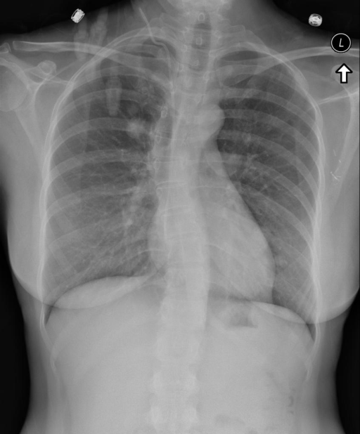

# chexbench_rad_restruct_0183
Ordinal 61; source Rad-Restruct; stopped-prefix record.

Is there anything abnormal in the lymph nodes?

## Complete options

- **A**: yes
- **B**: no

## Original images

Explicit answer: **B. no**; reference: **B**; correct: **True**.

Both medgemma and chest_xray_expert models confirm no visible hilar or mediastinal lymphadenopathy or abnormal lymph node enlargement on the CXR.

[Prediction](../../evidence/chexbench/predictions/M43-IM-GT-S50-CXR6/chexbench_rad_restruct_0183.json) · [own post-prediction feedback](../../evidence/chexbench/feedback/chexbench_rad_restruct_0183.json) · [exact context and Skill version](../../evidence/chexbench/contexts/chexbench_rad_restruct_0183.json) · [all main requests/responses](../../evidence/chexbench/services/calls/R50-AGENT/chexbench_rad_restruct_0183)

## Tool requests and observations

- medgemma: status=completed; [selection](../../evidence/chexbench/services/tool_selections/R50-AGENT/chexbench_rad_restruct_0183/1.json), [full request/result/stdout/stderr artifacts](../../evidence/chexbench/services/tool_cache/b0eb381d6c034e5846631e86fea5927162698559e70f30ca0f6b751fb2c30568).
- chest_xray_expert: status=completed; [selection](../../evidence/chexbench/services/tool_selections/R50-AGENT/chexbench_rad_restruct_0183/2.json), [full request/result/stdout/stderr artifacts](../../evidence/chexbench/services/tool_cache/a1b560944215071c53d39aa41efc7ee281c558a246ba4bcba01e6662dd3e9d9d).

## Skill and prior-image provenance

Selected IDs: []; prior same-image IDs: [].

This is dataset-label scoring and model/tool narrative, not clinical adjudication or Skill causal verification.
