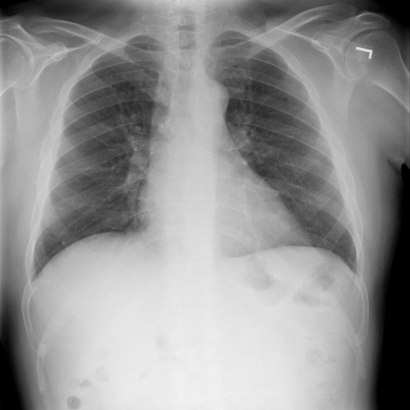

# chexbench_rad_restruct_0184
Ordinal 62; source Rad-Restruct; stopped-prefix record.

Are there any signs in the lung?

## Complete options

- **A**: yes
- **B**: no

## Original images

Explicit answer: **B. no**; reference: **B**; correct: **True**.

Both medgemma and chest_xray_expert models agree that the lung fields are clear with no obvious signs of pathology such as consolidation, effusion, or masses.

[Prediction](../../evidence/chexbench/predictions/M43-IM-GT-S50-CXR6/chexbench_rad_restruct_0184.json) · [own post-prediction feedback](../../evidence/chexbench/feedback/chexbench_rad_restruct_0184.json) · [exact context and Skill version](../../evidence/chexbench/contexts/chexbench_rad_restruct_0184.json) · [all main requests/responses](../../evidence/chexbench/services/calls/R50-AGENT/chexbench_rad_restruct_0184)

## Tool requests and observations

- medgemma: status=completed; [selection](../../evidence/chexbench/services/tool_selections/R50-AGENT/chexbench_rad_restruct_0184/1.json), [full request/result/stdout/stderr artifacts](../../evidence/chexbench/services/tool_cache/4f37cd4519e3d44c38e94f69cb5403ea22970dc5c945a01568498e2321190655).
- chest_xray_expert: status=completed; [selection](../../evidence/chexbench/services/tool_selections/R50-AGENT/chexbench_rad_restruct_0184/2.json), [full request/result/stdout/stderr artifacts](../../evidence/chexbench/services/tool_cache/46f47e0efea9b6470eb2a72dc95d8a9ebb5eaf28ff66a14708597397e00eb6bf).

## Skill and prior-image provenance

Selected IDs: []; prior same-image IDs: [].

This is dataset-label scoring and model/tool narrative, not clinical adjudication or Skill causal verification.
