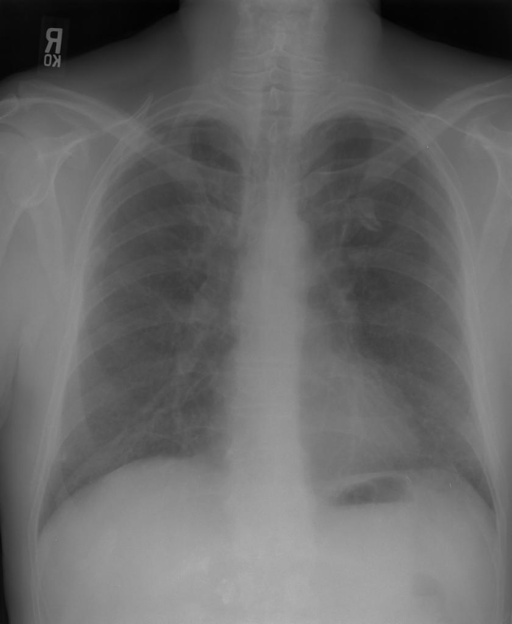

# chexbench_rad_restruct_0185
Ordinal 63; source Rad-Restruct; stopped-prefix record.

Are there any foreign objects?

## Complete options

- **A**: yes
- **B**: no

## Original images

Explicit answer: **B. no**; reference: **B**; correct: **True**.

Both specialized CXR models confirm no visible foreign objects, lines, tubes, or devices in the image.

[Prediction](../../evidence/chexbench/predictions/M43-IM-GT-S50-CXR6/chexbench_rad_restruct_0185.json) · [own post-prediction feedback](../../evidence/chexbench/feedback/chexbench_rad_restruct_0185.json) · [exact context and Skill version](../../evidence/chexbench/contexts/chexbench_rad_restruct_0185.json) · [all main requests/responses](../../evidence/chexbench/services/calls/R50-AGENT/chexbench_rad_restruct_0185)

## Tool requests and observations

- medgemma: status=completed; [selection](../../evidence/chexbench/services/tool_selections/R50-AGENT/chexbench_rad_restruct_0185/1.json), [full request/result/stdout/stderr artifacts](../../evidence/chexbench/services/tool_cache/e252ed7287810af28ca1d03a70514c66358eb993e6a7f3261f689ec8d47d805e).
- chest_xray_expert: status=completed; [selection](../../evidence/chexbench/services/tool_selections/R50-AGENT/chexbench_rad_restruct_0185/2.json), [full request/result/stdout/stderr artifacts](../../evidence/chexbench/services/tool_cache/2570097953bfa01dbb1d02cdafb3b00da7b9be82cf6b7b1f14667e4c38f2498b).

## Skill and prior-image provenance

Selected IDs: []; prior same-image IDs: [].

This is dataset-label scoring and model/tool narrative, not clinical adjudication or Skill causal verification.
