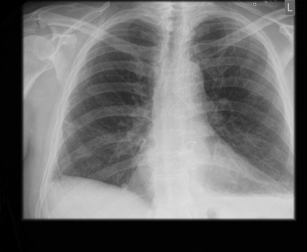
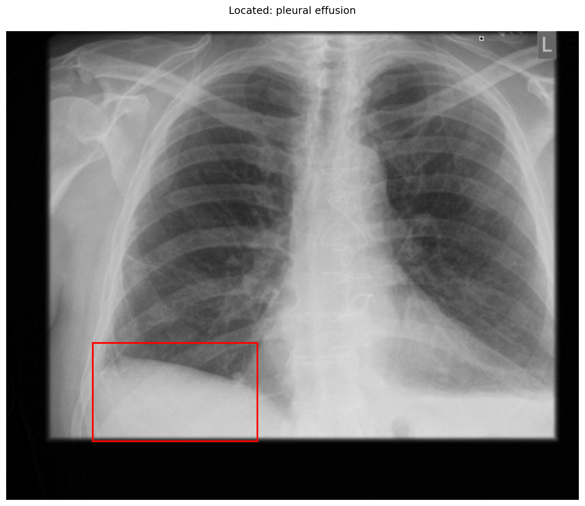

# chexbench_rad_restruct_0186
Ordinal 64; source Rad-Restruct; stopped-prefix record.

Are there any diseases in the pleura?

## Complete options

- **A**: no
- **B**: yes

## Original images

Explicit answer: **B. yes**; reference: **A**; correct: **False**.

Grounding visualization confirms a pleural effusion in the right lower hemithorax, indicating pleural disease.

[Prediction](../../evidence/chexbench/predictions/M43-IM-GT-S50-CXR6/chexbench_rad_restruct_0186.json) · [own post-prediction feedback](../../evidence/chexbench/feedback/chexbench_rad_restruct_0186.json) · [exact context and Skill version](../../evidence/chexbench/contexts/chexbench_rad_restruct_0186.json) · [all main requests/responses](../../evidence/chexbench/services/calls/R50-AGENT/chexbench_rad_restruct_0186)

## Tool requests and observations

- medgemma: status=completed; [selection](../../evidence/chexbench/services/tool_selections/R50-AGENT/chexbench_rad_restruct_0186/1.json), [full request/result/stdout/stderr artifacts](../../evidence/chexbench/services/tool_cache/2d905fd36897a46d82af2a0a3847af4ae2f9e15e07fef6d65404524e87136795).
- chest_xray_expert: status=completed; [selection](../../evidence/chexbench/services/tool_selections/R50-AGENT/chexbench_rad_restruct_0186/2.json), [full request/result/stdout/stderr artifacts](../../evidence/chexbench/services/tool_cache/0be43e4c528e431ae400fc4bc0589c4e2be45822d76628a7c98a046c89566f0e).
- xray_phrase_grounding: status=completed; [selection](../../evidence/chexbench/services/tool_selections/R50-AGENT/chexbench_rad_restruct_0186/3.json), [full request/result/stdout/stderr artifacts](../../evidence/chexbench/services/tool_cache/dc700884ebb002dde1c9ea76f361cdb96c6f98628bab61a8d963a44f3a231509).

## Skill and prior-image provenance

Selected IDs: []; prior same-image IDs: [].

This is dataset-label scoring and model/tool narrative, not clinical adjudication or Skill causal verification.
