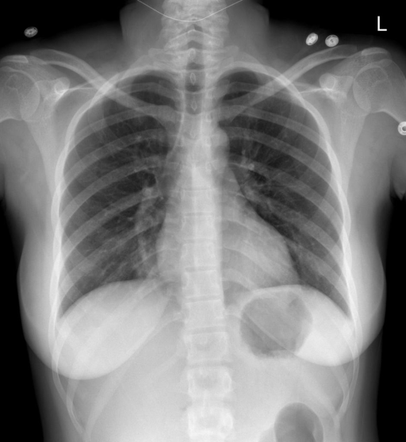

# chexbench_rad_restruct_0187
Ordinal 65; source Rad-Restruct; stopped-prefix record.

Is there anything abnormal in the abdomen?

## Complete options

- **A**: no
- **B**: yes

## Original images

Explicit answer: **A. no**; reference: **A**; correct: **True**.

Both expert models agree there is no obvious abnormality in the visible upper abdomen.

[Prediction](../../evidence/chexbench/predictions/M43-IM-GT-S50-CXR6/chexbench_rad_restruct_0187.json) · [own post-prediction feedback](../../evidence/chexbench/feedback/chexbench_rad_restruct_0187.json) · [exact context and Skill version](../../evidence/chexbench/contexts/chexbench_rad_restruct_0187.json) · [all main requests/responses](../../evidence/chexbench/services/calls/R50-AGENT/chexbench_rad_restruct_0187)

## Tool requests and observations

- medgemma: status=completed; [selection](../../evidence/chexbench/services/tool_selections/R50-AGENT/chexbench_rad_restruct_0187/1.json), [full request/result/stdout/stderr artifacts](../../evidence/chexbench/services/tool_cache/62fdc14a754d5cb1870090686f57546c6d804d40beac7bc5d75ad0c5b4aaca17).
- chest_xray_expert: status=completed; [selection](../../evidence/chexbench/services/tool_selections/R50-AGENT/chexbench_rad_restruct_0187/2.json), [full request/result/stdout/stderr artifacts](../../evidence/chexbench/services/tool_cache/c4b1a9bc44d41eb84739f81a5e2ea881cb67f4c2061829c96f8c5c1ee048cc87).

## Skill and prior-image provenance

Selected IDs: []; prior same-image IDs: [].

This is dataset-label scoring and model/tool narrative, not clinical adjudication or Skill causal verification.
