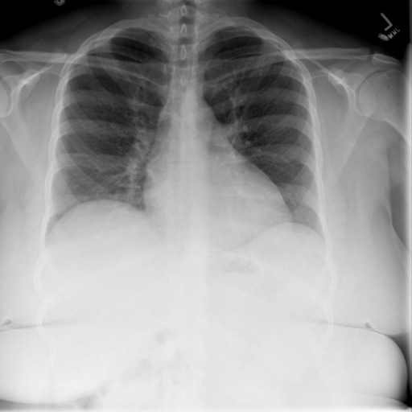

# chexbench_rad_restruct_0188
Ordinal 66; source Rad-Restruct; stopped-prefix record.

Are there any diseases in the pleura?

## Complete options

- **A**: no
- **B**: yes

## Original images

Explicit answer: **A. no**; reference: **A**; correct: **True**.

Both MedGemma and CheXagent confirm no visible pleural effusion, pneumothorax, or thickening on this CXR.

[Prediction](../../evidence/chexbench/predictions/M43-IM-GT-S50-CXR6/chexbench_rad_restruct_0188.json) · [own post-prediction feedback](../../evidence/chexbench/feedback/chexbench_rad_restruct_0188.json) · [exact context and Skill version](../../evidence/chexbench/contexts/chexbench_rad_restruct_0188.json) · [all main requests/responses](../../evidence/chexbench/services/calls/R50-AGENT/chexbench_rad_restruct_0188)

## Tool requests and observations

- medgemma: status=completed; [selection](../../evidence/chexbench/services/tool_selections/R50-AGENT/chexbench_rad_restruct_0188/1.json), [full request/result/stdout/stderr artifacts](../../evidence/chexbench/services/tool_cache/2b48caba53ad4d580a693f28604756653ee613445a222d3d7730195b9070608a).
- chest_xray_expert: status=completed; [selection](../../evidence/chexbench/services/tool_selections/R50-AGENT/chexbench_rad_restruct_0188/2.json), [full request/result/stdout/stderr artifacts](../../evidence/chexbench/services/tool_cache/d1a6d55f4088ac8023f3b3deb1cef2bea651238f8a5a8ff8fb55f7ee8eb9c259).

## Skill and prior-image provenance

Selected IDs: []; prior same-image IDs: [].

This is dataset-label scoring and model/tool narrative, not clinical adjudication or Skill causal verification.
