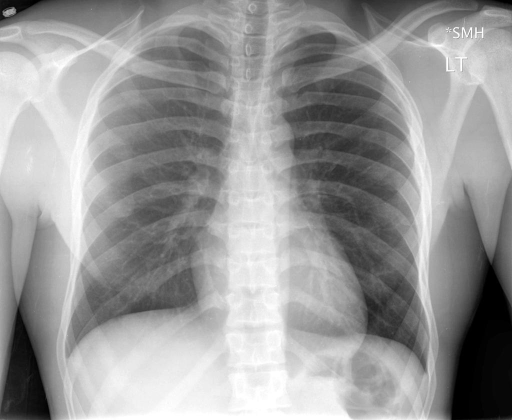

# chexbench_rad_restruct_0189
Ordinal 67; source Rad-Restruct; stopped-prefix record.

Are there any signs in the skeletal system?

## Complete options

- **A**: yes
- **B**: no

## Original images

Explicit answer: **B. no**; reference: **B**; correct: **True**.

Both expert models confirm no visible skeletal abnormalities such as fractures or lytic lesions in the chest X-ray.

[Prediction](../../evidence/chexbench/predictions/M43-IM-GT-S50-CXR6/chexbench_rad_restruct_0189.json) · [own post-prediction feedback](../../evidence/chexbench/feedback/chexbench_rad_restruct_0189.json) · [exact context and Skill version](../../evidence/chexbench/contexts/chexbench_rad_restruct_0189.json) · [all main requests/responses](../../evidence/chexbench/services/calls/R50-AGENT/chexbench_rad_restruct_0189)

## Tool requests and observations

- medgemma: status=completed; [selection](../../evidence/chexbench/services/tool_selections/R50-AGENT/chexbench_rad_restruct_0189/1.json), [full request/result/stdout/stderr artifacts](../../evidence/chexbench/services/tool_cache/825a21939cffd67f068104475ce5fca8865b7262b23e2a2714fbd079da47046a).
- chest_xray_expert: status=completed; [selection](../../evidence/chexbench/services/tool_selections/R50-AGENT/chexbench_rad_restruct_0189/2.json), [full request/result/stdout/stderr artifacts](../../evidence/chexbench/services/tool_cache/b35f136852f2d642515f0cbf80e92a431ad4b20a85c89c7bcb2da8364546ab86).

## Skill and prior-image provenance

Selected IDs: []; prior same-image IDs: [].

This is dataset-label scoring and model/tool narrative, not clinical adjudication or Skill causal verification.
