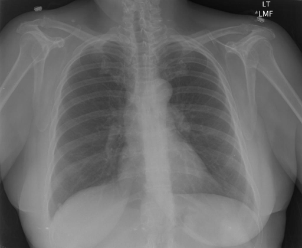

# chexbench_rad_restruct_0190
Ordinal 68; source Rad-Restruct; stopped-prefix record.

Are there any signs in the mediastinum?

## Complete options

- **A**: yes
- **B**: no

## Original images

Explicit answer: **B. no**; reference: **B**; correct: **True**.

Both expert models assessed the mediastinum as normal with no signs of widening, mass, or abnormal contour.

[Prediction](../../evidence/chexbench/predictions/M43-IM-GT-S50-CXR6/chexbench_rad_restruct_0190.json) · [own post-prediction feedback](../../evidence/chexbench/feedback/chexbench_rad_restruct_0190.json) · [exact context and Skill version](../../evidence/chexbench/contexts/chexbench_rad_restruct_0190.json) · [all main requests/responses](../../evidence/chexbench/services/calls/R50-AGENT/chexbench_rad_restruct_0190)

## Tool requests and observations

- medgemma: status=completed; [selection](../../evidence/chexbench/services/tool_selections/R50-AGENT/chexbench_rad_restruct_0190/1.json), [full request/result/stdout/stderr artifacts](../../evidence/chexbench/services/tool_cache/26ea2c7c72a113243ba59592796aac88ec8ae78eab82167a2f7c9d7abba4a4b3).
- chest_xray_expert: status=completed; [selection](../../evidence/chexbench/services/tool_selections/R50-AGENT/chexbench_rad_restruct_0190/2.json), [full request/result/stdout/stderr artifacts](../../evidence/chexbench/services/tool_cache/d9f4457d37469ec6bed950ee48ebe92fc402937003941f540980bd3e504fcf9d).

## Skill and prior-image provenance

Selected IDs: []; prior same-image IDs: [].

This is dataset-label scoring and model/tool narrative, not clinical adjudication or Skill causal verification.
