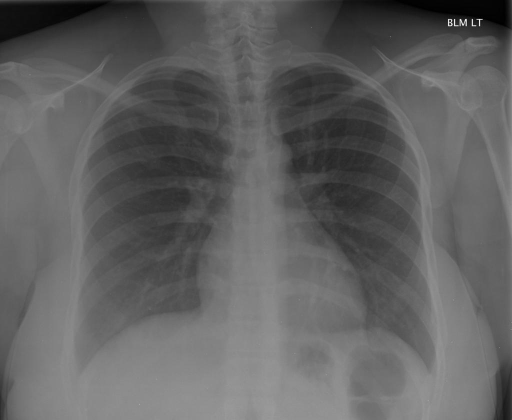

# chexbench_rad_restruct_0191
Ordinal 69; source Rad-Restruct; stopped-prefix record.

Are there any signs in the thorax?

## Complete options

- **A**: yes
- **B**: no

## Original images

Explicit answer: **B. no**; reference: **B**; correct: **True**.

Both medgemma and chest_xray_expert independently report no abnormal thoracic signs such as consolidation, effusion, pneumothorax, or masses.

[Prediction](../../evidence/chexbench/predictions/M43-IM-GT-S50-CXR6/chexbench_rad_restruct_0191.json) · [own post-prediction feedback](../../evidence/chexbench/feedback/chexbench_rad_restruct_0191.json) · [exact context and Skill version](../../evidence/chexbench/contexts/chexbench_rad_restruct_0191.json) · [all main requests/responses](../../evidence/chexbench/services/calls/R50-AGENT/chexbench_rad_restruct_0191)

## Tool requests and observations

- medgemma: status=completed; [selection](../../evidence/chexbench/services/tool_selections/R50-AGENT/chexbench_rad_restruct_0191/1.json), [full request/result/stdout/stderr artifacts](../../evidence/chexbench/services/tool_cache/d0a529ce5ea06f823642469a6f554deece06cb69510b241daab1937831b15d91).
- chest_xray_expert: status=completed; [selection](../../evidence/chexbench/services/tool_selections/R50-AGENT/chexbench_rad_restruct_0191/2.json), [full request/result/stdout/stderr artifacts](../../evidence/chexbench/services/tool_cache/af90eddbee74ec5cf359c3a7d630393986b178e5eab8a5e1f08faf88a42deb71).

## Skill and prior-image provenance

Selected IDs: []; prior same-image IDs: [].

This is dataset-label scoring and model/tool narrative, not clinical adjudication or Skill causal verification.
