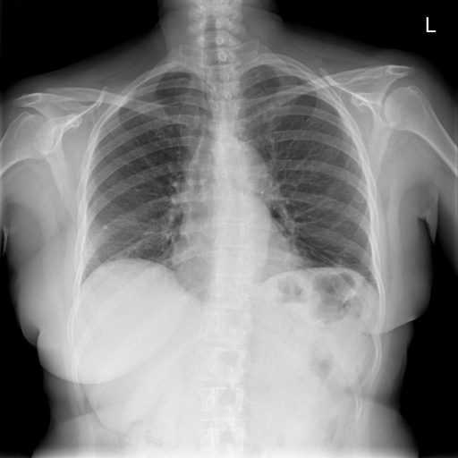

# chexbench_rad_restruct_0192
Ordinal 70; source Rad-Restruct; stopped-prefix record.

Are there any signs in the pleura?

## Complete options

- **A**: yes
- **B**: no

## Original images

Explicit answer: **B. no**; reference: **A**; correct: **False**.

Both MedGemma and CheXagent confirm clear costophrenic angles and no visible pleural line, effusion, or thickening.

[Prediction](../../evidence/chexbench/predictions/M43-IM-GT-S50-CXR6/chexbench_rad_restruct_0192.json) · [own post-prediction feedback](../../evidence/chexbench/feedback/chexbench_rad_restruct_0192.json) · [exact context and Skill version](../../evidence/chexbench/contexts/chexbench_rad_restruct_0192.json) · [all main requests/responses](../../evidence/chexbench/services/calls/R50-AGENT/chexbench_rad_restruct_0192)

## Tool requests and observations

- medgemma: status=completed; [selection](../../evidence/chexbench/services/tool_selections/R50-AGENT/chexbench_rad_restruct_0192/1.json), [full request/result/stdout/stderr artifacts](../../evidence/chexbench/services/tool_cache/36e5cfa291b1bd109e9847e975ba35ba10cac128522453ab80b1630cfd22cc23).
- chest_xray_expert: status=completed; [selection](../../evidence/chexbench/services/tool_selections/R50-AGENT/chexbench_rad_restruct_0192/2.json), [full request/result/stdout/stderr artifacts](../../evidence/chexbench/services/tool_cache/8bfaf6084182cde73b92a5b0f4d9b05b860dd89fc5b1af5d06343f9aef9fa74e).

## Skill and prior-image provenance

Selected IDs: []; prior same-image IDs: [].

This is dataset-label scoring and model/tool narrative, not clinical adjudication or Skill causal verification.
