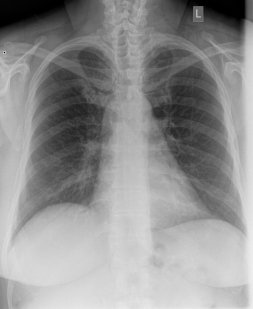

# chexbench_rad_restruct_0193
Ordinal 71; source Rad-Restruct; stopped-prefix record.

Is there anything abnormal in the skeletal system?

## Complete options

- **A**: no
- **B**: yes

## Original images

Explicit answer: **A. no**; reference: **B**; correct: **False**.

Both medgemma and chest_xray_expert models confirm no visible skeletal abnormalities such as fractures, lytic lesions, or deformities in the ribs, clavicles, scapulae, or spine.

[Prediction](../../evidence/chexbench/predictions/M43-IM-GT-S50-CXR6/chexbench_rad_restruct_0193.json) · [own post-prediction feedback](../../evidence/chexbench/feedback/chexbench_rad_restruct_0193.json) · [exact context and Skill version](../../evidence/chexbench/contexts/chexbench_rad_restruct_0193.json) · [all main requests/responses](../../evidence/chexbench/services/calls/R50-AGENT/chexbench_rad_restruct_0193)

## Tool requests and observations

- medgemma: status=completed; [selection](../../evidence/chexbench/services/tool_selections/R50-AGENT/chexbench_rad_restruct_0193/1.json), [full request/result/stdout/stderr artifacts](../../evidence/chexbench/services/tool_cache/9e6839e08c7783323b705dab086a4db71b01b4cce78624a6a4150a96bd8c5aa7).
- chest_xray_expert: status=completed; [selection](../../evidence/chexbench/services/tool_selections/R50-AGENT/chexbench_rad_restruct_0193/2.json), [full request/result/stdout/stderr artifacts](../../evidence/chexbench/services/tool_cache/4297ddcd5ebc3f09a092eda11f8f22a9d4bbc6c58f7255d4ce34bc8eaaddea8f).

## Skill and prior-image provenance

Selected IDs: []; prior same-image IDs: [].

This is dataset-label scoring and model/tool narrative, not clinical adjudication or Skill causal verification.
