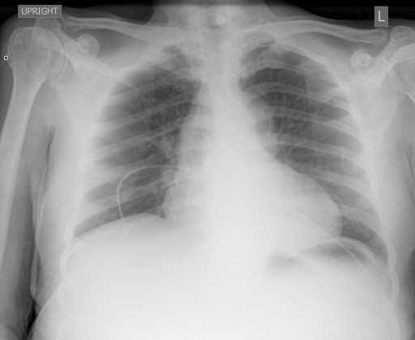

# chexbench_rad_restruct_0194
Ordinal 72; source Rad-Restruct; stopped-prefix record.

Is there anything abnormal in the cardiovascular system?

## Complete options

- **A**: yes
- **B**: no

## Original images

Explicit answer: **A. yes**; reference: **A**; correct: **True**.

Both MedGemma and CheXagent identify cardiomegaly, indicating an abnormality in the cardiovascular system.

[Prediction](../../evidence/chexbench/predictions/M43-IM-GT-S50-CXR6/chexbench_rad_restruct_0194.json) · [own post-prediction feedback](../../evidence/chexbench/feedback/chexbench_rad_restruct_0194.json) · [exact context and Skill version](../../evidence/chexbench/contexts/chexbench_rad_restruct_0194.json) · [all main requests/responses](../../evidence/chexbench/services/calls/R50-AGENT/chexbench_rad_restruct_0194)

## Tool requests and observations

- medgemma: status=completed; [selection](../../evidence/chexbench/services/tool_selections/R50-AGENT/chexbench_rad_restruct_0194/1.json), [full request/result/stdout/stderr artifacts](../../evidence/chexbench/services/tool_cache/e293a41a174a4fe5661ff1f0584dfb15353dc59f80f834d57e215a4d3b3a7033).
- chest_xray_expert: status=completed; [selection](../../evidence/chexbench/services/tool_selections/R50-AGENT/chexbench_rad_restruct_0194/2.json), [full request/result/stdout/stderr artifacts](../../evidence/chexbench/services/tool_cache/519d586f70536a99069e7f83e27a51abd9107bf1e25cf33a0da6fafdd4a423e3).

## Skill and prior-image provenance

Selected IDs: []; prior same-image IDs: ['chexbench_rad_restruct_0129'].

This is dataset-label scoring and model/tool narrative, not clinical adjudication or Skill causal verification.
