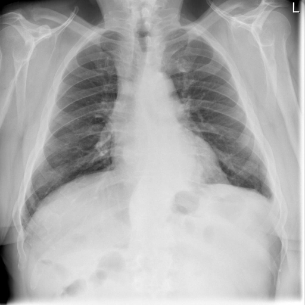

# chexbench_rad_restruct_0195
Ordinal 73; source Rad-Restruct; stopped-prefix record.

Are there any diseases in the lung?

## Complete options

- **A**: yes
- **B**: no

## Original images

Explicit answer: **B. no**; reference: **A**; correct: **False**.

Both expert models and visual inspection indicate clear lungs without consolidation, effusion, or pneumothorax.

[Prediction](../../evidence/chexbench/predictions/M43-IM-GT-S50-CXR6/chexbench_rad_restruct_0195.json) · [own post-prediction feedback](../../evidence/chexbench/feedback/chexbench_rad_restruct_0195.json) · [exact context and Skill version](../../evidence/chexbench/contexts/chexbench_rad_restruct_0195.json) · [all main requests/responses](../../evidence/chexbench/services/calls/R50-AGENT/chexbench_rad_restruct_0195)

## Tool requests and observations

- medgemma: status=completed; [selection](../../evidence/chexbench/services/tool_selections/R50-AGENT/chexbench_rad_restruct_0195/1.json), [full request/result/stdout/stderr artifacts](../../evidence/chexbench/services/tool_cache/0cb7fdd0171748a03436515ebe31b4160b85e2c0c4c8c7087c8255afd72133f4).
- chest_xray_expert: status=completed; [selection](../../evidence/chexbench/services/tool_selections/R50-AGENT/chexbench_rad_restruct_0195/2.json), [full request/result/stdout/stderr artifacts](../../evidence/chexbench/services/tool_cache/e1a827dcff70a5d3fdccb210906e693ecb28be7721783c032c039b40d7ae0f20).

## Skill and prior-image provenance

Selected IDs: []; prior same-image IDs: ['chexbench_rad_restruct_0176'].

This is dataset-label scoring and model/tool narrative, not clinical adjudication or Skill causal verification.
