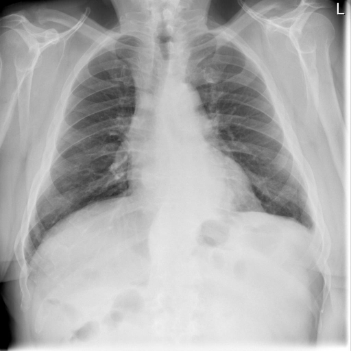

# chexbench_rad_restruct_0197
Ordinal 75; source Rad-Restruct; stopped-prefix record.

Are there any diseases in the pleura?

## Complete options

- **A**: no
- **B**: yes

## Original images

Explicit answer: **A. no**; reference: **B**; correct: **False**.

Both expert models and visual inspection confirm clear costophrenic angles with no evidence of pleural effusion, pneumothorax, or thickening.

[Prediction](../../evidence/chexbench/predictions/M43-IM-GT-S50-CXR6/chexbench_rad_restruct_0197.json) · [own post-prediction feedback](../../evidence/chexbench/feedback/chexbench_rad_restruct_0197.json) · [exact context and Skill version](../../evidence/chexbench/contexts/chexbench_rad_restruct_0197.json) · [all main requests/responses](../../evidence/chexbench/services/calls/R50-AGENT/chexbench_rad_restruct_0197)

## Tool requests and observations

- chest_xray_expert: status=completed; [selection](../../evidence/chexbench/services/tool_selections/R50-AGENT/chexbench_rad_restruct_0197/1.json), [full request/result/stdout/stderr artifacts](../../evidence/chexbench/services/tool_cache/21adcac50b11331057c0009a393139e479190f7694dad62053967f9a2ae2e415).
- medgemma: status=completed; [selection](../../evidence/chexbench/services/tool_selections/R50-AGENT/chexbench_rad_restruct_0197/2.json), [full request/result/stdout/stderr artifacts](../../evidence/chexbench/services/tool_cache/5c7905012e5544bdee0c0ffe825d1a1fe6f34d2fa6632cf28a76cb8acb131bdc).

## Skill and prior-image provenance

Selected IDs: []; prior same-image IDs: ['chexbench_rad_restruct_0176', 'chexbench_rad_restruct_0195'].

This is dataset-label scoring and model/tool narrative, not clinical adjudication or Skill causal verification.
