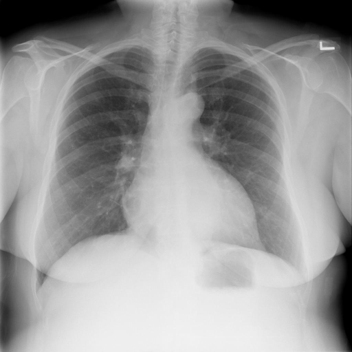

# chexbench_rad_restruct_0198
Ordinal 76; source Rad-Restruct; stopped-prefix record.

Is there anything abnormal in the cardiovascular system?

## Complete options

- **A**: yes
- **B**: no

## Original images

Explicit answer: **A. yes**; reference: **A**; correct: **True**.

Both medgemma and chest_xray_expert identify cardiomegaly, indicating an abnormality in the cardiovascular system.

[Prediction](../../evidence/chexbench/predictions/M43-IM-GT-S50-CXR6/chexbench_rad_restruct_0198.json) · [own post-prediction feedback](../../evidence/chexbench/feedback/chexbench_rad_restruct_0198.json) · [exact context and Skill version](../../evidence/chexbench/contexts/chexbench_rad_restruct_0198.json) · [all main requests/responses](../../evidence/chexbench/services/calls/R50-AGENT/chexbench_rad_restruct_0198)

## Tool requests and observations

- medgemma: status=completed; [selection](../../evidence/chexbench/services/tool_selections/R50-AGENT/chexbench_rad_restruct_0198/1.json), [full request/result/stdout/stderr artifacts](../../evidence/chexbench/services/tool_cache/81e9bb32a9506d46b2dbd7c0e0d0cdf11482941e34c036beb0bab84c579599f7).
- chest_xray_expert: status=completed; [selection](../../evidence/chexbench/services/tool_selections/R50-AGENT/chexbench_rad_restruct_0198/2.json), [full request/result/stdout/stderr artifacts](../../evidence/chexbench/services/tool_cache/da15a62a9caf90989496e63e00b0593ca67c1a158d738124ff707d1acabba5ca).

## Skill and prior-image provenance

Selected IDs: []; prior same-image IDs: ['chexbench_rad_restruct_0182'].

This is dataset-label scoring and model/tool narrative, not clinical adjudication or Skill causal verification.
