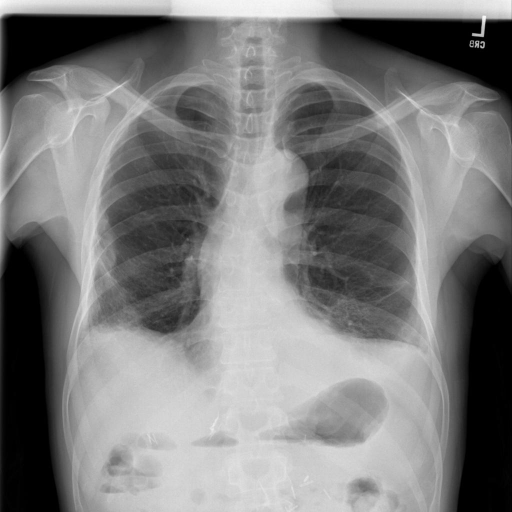
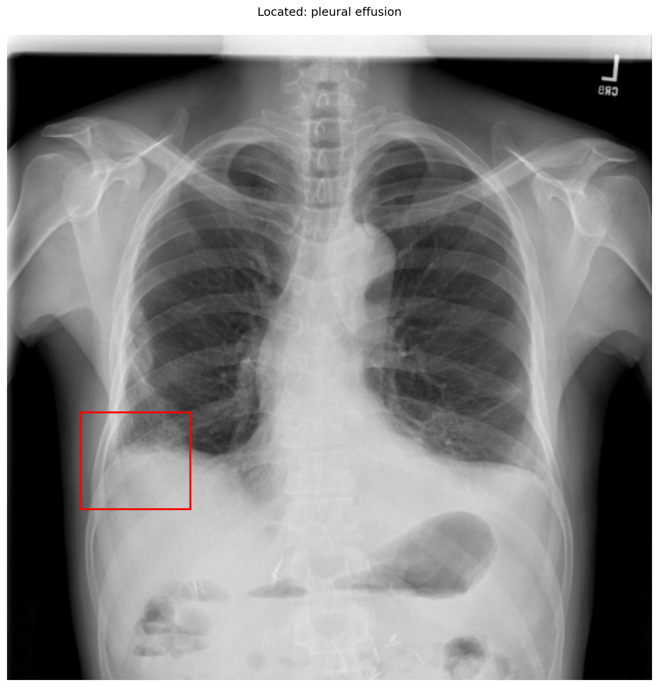

# chexbench_rad_restruct_0199
Ordinal 77; source Rad-Restruct; stopped-prefix record.

Are there any diseases in the pleura?

## Complete options

- **A**: yes
- **B**: no

## Original images

Explicit answer: **A. yes**; reference: **A**; correct: **True**.

Grounding confirms pleural effusion at the right costophrenic angle, indicating pleural disease.

[Prediction](../../evidence/chexbench/predictions/M43-IM-GT-S50-CXR6/chexbench_rad_restruct_0199.json) · [own post-prediction feedback](../../evidence/chexbench/feedback/chexbench_rad_restruct_0199.json) · [exact context and Skill version](../../evidence/chexbench/contexts/chexbench_rad_restruct_0199.json) · [all main requests/responses](../../evidence/chexbench/services/calls/R50-AGENT/chexbench_rad_restruct_0199)

## Tool requests and observations

- medgemma: status=completed; [selection](../../evidence/chexbench/services/tool_selections/R50-AGENT/chexbench_rad_restruct_0199/1.json), [full request/result/stdout/stderr artifacts](../../evidence/chexbench/services/tool_cache/bcf035c9ccf2a726709fc85daf08547d183160187b0ee3fad915b5ffb18ee5ab).
- chest_xray_expert: status=completed; [selection](../../evidence/chexbench/services/tool_selections/R50-AGENT/chexbench_rad_restruct_0199/2.json), [full request/result/stdout/stderr artifacts](../../evidence/chexbench/services/tool_cache/6374bf7cc9629d5b10d145e0be5a93b4115bb31d4056c5eb7cf68f7bb453cf0d).
- xray_phrase_grounding: status=completed; [selection](../../evidence/chexbench/services/tool_selections/R50-AGENT/chexbench_rad_restruct_0199/3.json), [full request/result/stdout/stderr artifacts](../../evidence/chexbench/services/tool_cache/badbd80da56ff5183ad983d59a89b426f34bab54dbfb1b5e2b87f2807505dfc2).

## Skill and prior-image provenance

Selected IDs: []; prior same-image IDs: [].

This is dataset-label scoring and model/tool narrative, not clinical adjudication or Skill causal verification.
