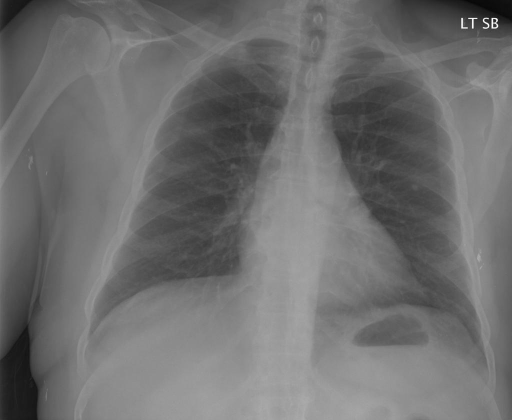

# chexbench_rad_restruct_0200
Ordinal 78; source Rad-Restruct; stopped-prefix record.

Are there any diseases in the skeletal system?

## Complete options

- **A**: no
- **B**: yes

## Original images

Explicit answer: **A. no**; reference: **B**; correct: **False**.

The chest X-ray shows no visible fractures, lytic lesions, or other skeletal abnormalities in the ribs, clavicles, scapulae, or spine.

[Prediction](../../evidence/chexbench/predictions/M43-IM-GT-S50-CXR6/chexbench_rad_restruct_0200.json) · [own post-prediction feedback](../../evidence/chexbench/feedback/chexbench_rad_restruct_0200.json) · [exact context and Skill version](../../evidence/chexbench/contexts/chexbench_rad_restruct_0200.json) · [all main requests/responses](../../evidence/chexbench/services/calls/R50-AGENT/chexbench_rad_restruct_0200)

## Tool requests and observations

- medgemma: status=completed; [selection](../../evidence/chexbench/services/tool_selections/R50-AGENT/chexbench_rad_restruct_0200/1.json), [full request/result/stdout/stderr artifacts](../../evidence/chexbench/services/tool_cache/5a13947cc845195818581e84bba824bf31618acc886a07fd1957d8f556f54f5b).

## Skill and prior-image provenance

Selected IDs: []; prior same-image IDs: [].

This is dataset-label scoring and model/tool narrative, not clinical adjudication or Skill causal verification.
