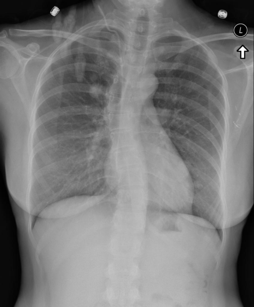
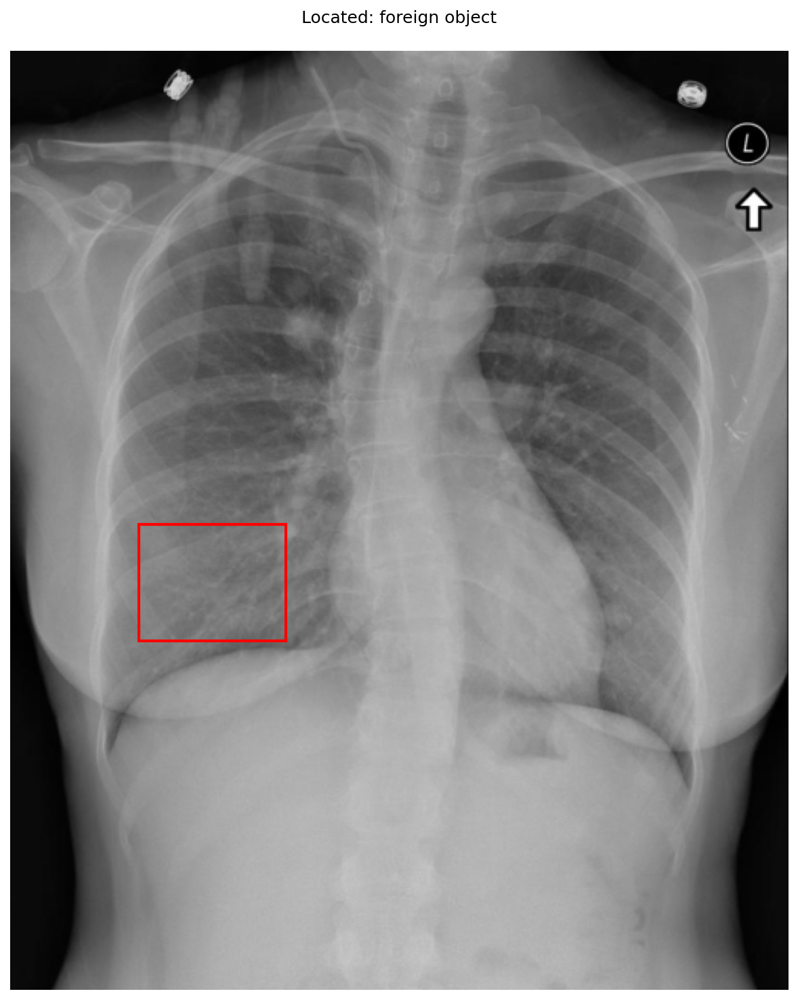

# chexbench_rad_restruct_0201
Ordinal 79; source Rad-Restruct; stopped-prefix record.

Are there any foreign objects?

## Complete options

- **A**: yes
- **B**: no

## Original images

Explicit answer: **A. yes**; reference: **A**; correct: **True**.

External ECG monitoring leads and markers are clearly visible on the upper chest, confirming the presence of foreign objects.

[Prediction](../../evidence/chexbench/predictions/M43-IM-GT-S50-CXR6/chexbench_rad_restruct_0201.json) · [own post-prediction feedback](../../evidence/chexbench/feedback/chexbench_rad_restruct_0201.json) · [exact context and Skill version](../../evidence/chexbench/contexts/chexbench_rad_restruct_0201.json) · [all main requests/responses](../../evidence/chexbench/services/calls/R50-AGENT/chexbench_rad_restruct_0201)

## Tool requests and observations

- xray_phrase_grounding: status=completed; [selection](../../evidence/chexbench/services/tool_selections/R50-AGENT/chexbench_rad_restruct_0201/1.json), [full request/result/stdout/stderr artifacts](../../evidence/chexbench/services/tool_cache/9502052d16576cf0ba81434812ba80ce4596111ffc3db163ecc73bb0c55c1667).

## Skill and prior-image provenance

Selected IDs: []; prior same-image IDs: ['chexbench_rad_restruct_0183'].

This is dataset-label scoring and model/tool narrative, not clinical adjudication or Skill causal verification.
