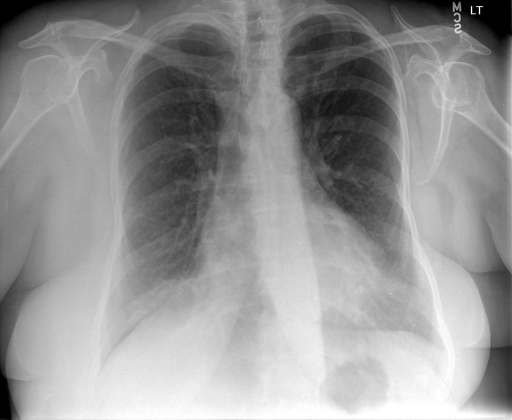
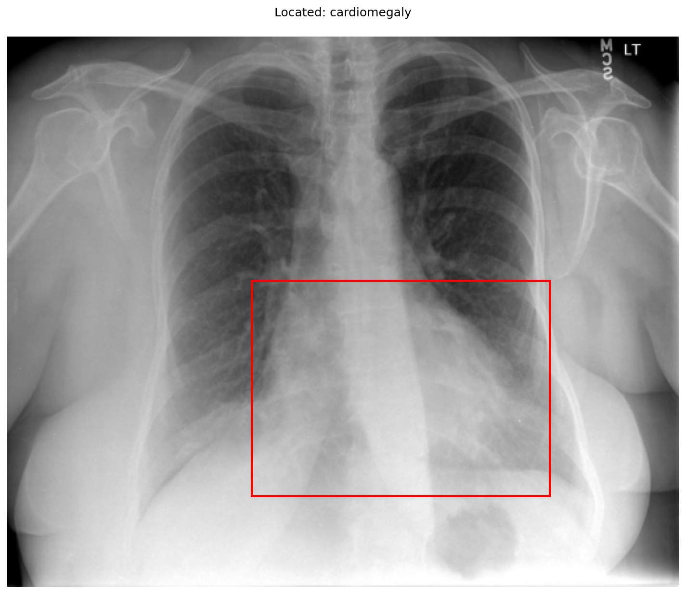

# chexbench_rad_restruct_0202
Ordinal 80; source Rad-Restruct; stopped-prefix record.

Are there any diseases in the cardiovascular system?

## Complete options

- **A**: no
- **B**: yes

## Original images

Explicit answer: **B. yes**; reference: **B**; correct: **True**.

The xray_phrase_grounding tool visually localized cardiomegaly with a bounding box over the enlarged cardiac silhouette, confirming a cardiovascular abnormality despite the conflicting chest_xray_expert response.

[Prediction](../../evidence/chexbench/predictions/M43-IM-GT-S50-CXR6/chexbench_rad_restruct_0202.json) · [own post-prediction feedback](../../evidence/chexbench/feedback/chexbench_rad_restruct_0202.json) · [exact context and Skill version](../../evidence/chexbench/contexts/chexbench_rad_restruct_0202.json) · [all main requests/responses](../../evidence/chexbench/services/calls/R50-AGENT/chexbench_rad_restruct_0202)

## Tool requests and observations

- medgemma: status=completed; [selection](../../evidence/chexbench/services/tool_selections/R50-AGENT/chexbench_rad_restruct_0202/1.json), [full request/result/stdout/stderr artifacts](../../evidence/chexbench/services/tool_cache/74761c0bc3397ec4373eb72b69eca3a3a03a781d256b657225e232df4d27b585).
- chest_xray_expert: status=completed; [selection](../../evidence/chexbench/services/tool_selections/R50-AGENT/chexbench_rad_restruct_0202/2.json), [full request/result/stdout/stderr artifacts](../../evidence/chexbench/services/tool_cache/0113e92ba4cac583b4540f7f1838d85580fdc731472f12ece5b09fbd2d772784).
- xray_phrase_grounding: status=completed; [selection](../../evidence/chexbench/services/tool_selections/R50-AGENT/chexbench_rad_restruct_0202/3.json), [full request/result/stdout/stderr artifacts](../../evidence/chexbench/services/tool_cache/c496ff061b8a1a7f9506dbe30fc294de0a142be79c2b06531fdce45c529594ea).

## Skill and prior-image provenance

Selected IDs: []; prior same-image IDs: [].

This is dataset-label scoring and model/tool narrative, not clinical adjudication or Skill causal verification.
