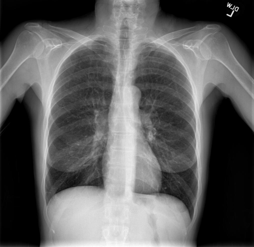

# chexbench_rad_restruct_0203
Ordinal 81; source Rad-Restruct; stopped-prefix record.

Are there any signs in the skeletal system?

## Complete options

- **A**: no
- **B**: yes

## Original images

Explicit answer: **A. no**; reference: **B**; correct: **False**.

The chest X-ray shows intact ribs, clavicles, scapulae, and spine with no visible fractures, lesions, or skeletal abnormalities.

[Prediction](../../evidence/chexbench/predictions/M43-IM-GT-S50-CXR6/chexbench_rad_restruct_0203.json) · [own post-prediction feedback](../../evidence/chexbench/feedback/chexbench_rad_restruct_0203.json) · [exact context and Skill version](../../evidence/chexbench/contexts/chexbench_rad_restruct_0203.json) · [all main requests/responses](../../evidence/chexbench/services/calls/R50-AGENT/chexbench_rad_restruct_0203)

## Tool requests and observations

- medgemma: status=completed; [selection](../../evidence/chexbench/services/tool_selections/R50-AGENT/chexbench_rad_restruct_0203/1.json), [full request/result/stdout/stderr artifacts](../../evidence/chexbench/services/tool_cache/2833dbd674c15d7844ec63720c45d9ea7a5b03475faea37ac84ad56bb7812d35).

## Skill and prior-image provenance

Selected IDs: []; prior same-image IDs: [].

This is dataset-label scoring and model/tool narrative, not clinical adjudication or Skill causal verification.
