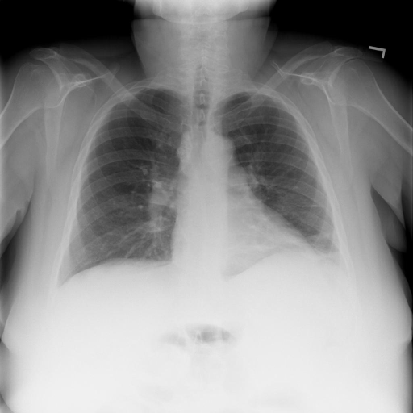
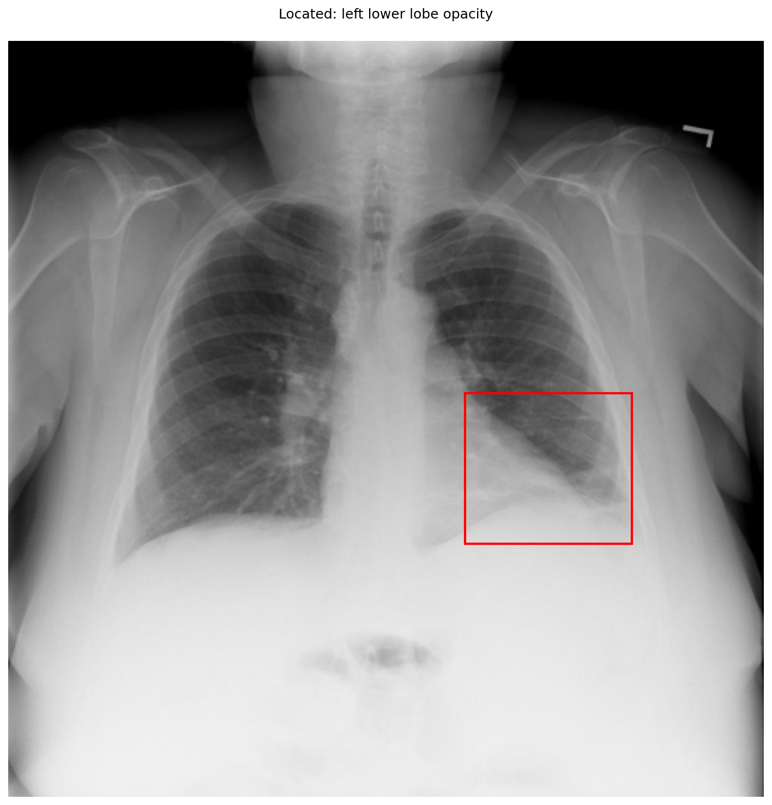

# chexbench_rad_restruct_0204
Ordinal 82; source Rad-Restruct; stopped-prefix record.

Are there any diseases in the lung?

## Complete options

- **A**: yes
- **B**: no

## Original images

Explicit answer: **A. yes**; reference: **A**; correct: **True**.

Phrase grounding confirms a left lower lobe opacity, and multiple models identify atelectasis or possible effusion, indicating lung pathology.

[Prediction](../../evidence/chexbench/predictions/M43-IM-GT-S50-CXR6/chexbench_rad_restruct_0204.json) · [own post-prediction feedback](../../evidence/chexbench/feedback/chexbench_rad_restruct_0204.json) · [exact context and Skill version](../../evidence/chexbench/contexts/chexbench_rad_restruct_0204.json) · [all main requests/responses](../../evidence/chexbench/services/calls/R50-AGENT/chexbench_rad_restruct_0204)

## Tool requests and observations

- medgemma: status=completed; [selection](../../evidence/chexbench/services/tool_selections/R50-AGENT/chexbench_rad_restruct_0204/1.json), [full request/result/stdout/stderr artifacts](../../evidence/chexbench/services/tool_cache/377f4850a08a453e76dc11ec2f3d89fdeb99bb5ae710046959449c500dc81c39).
- llava_rad: status=completed; [selection](../../evidence/chexbench/services/tool_selections/R50-AGENT/chexbench_rad_restruct_0204/2.json), [full request/result/stdout/stderr artifacts](../../evidence/chexbench/services/tool_cache/0c909c3c478b2b7c7f445d6e55d3a72db3b00600ae62a5da3b00d36dfa6e0399).
- chest_xray_expert: status=completed; [selection](../../evidence/chexbench/services/tool_selections/R50-AGENT/chexbench_rad_restruct_0204/3.json), [full request/result/stdout/stderr artifacts](../../evidence/chexbench/services/tool_cache/ff08eab2640b7e06ee7604c0f7693715d440c099ed6b4c07d8c74d6fc1d06eca).
- xray_phrase_grounding: status=completed; [selection](../../evidence/chexbench/services/tool_selections/R50-AGENT/chexbench_rad_restruct_0204/4.json), [full request/result/stdout/stderr artifacts](../../evidence/chexbench/services/tool_cache/dbe29049775098473ce603f7b09eadb37d6e9d0a7f2429bd3f16157df1debd8d).

- medvlm_r1: status=completed; [selection](../../evidence/chexbench/services/tool_selections/R50-AGENT/chexbench_rad_restruct_0204/5.json), [full request/result/stdout/stderr artifacts](../../evidence/chexbench/services/tool_cache/9e98dba40642aa02e636557e85e5e753153a4548eb933fa5997dca1db52748e2).

## Skill and prior-image provenance

Selected IDs: []; prior same-image IDs: [].

This is dataset-label scoring and model/tool narrative, not clinical adjudication or Skill causal verification.
