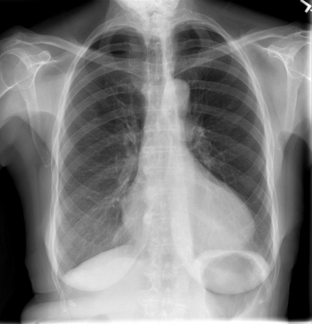

# chexbench_rad_restruct_0205
Ordinal 83; source Rad-Restruct; stopped-prefix record.

Is there anything abnormal in the lung?

## Complete options

- **A**: yes
- **B**: no

## Original images

Explicit answer: **B. no**; reference: **A**; correct: **False**.

Both medgemma and chest_xray_expert confirm the lung fields are clear without focal consolidation, mass, or pneumothorax.

[Prediction](../../evidence/chexbench/predictions/M43-IM-GT-S50-CXR6/chexbench_rad_restruct_0205.json) · [own post-prediction feedback](../../evidence/chexbench/feedback/chexbench_rad_restruct_0205.json) · [exact context and Skill version](../../evidence/chexbench/contexts/chexbench_rad_restruct_0205.json) · [all main requests/responses](../../evidence/chexbench/services/calls/R50-AGENT/chexbench_rad_restruct_0205)

## Tool requests and observations

- medgemma: status=completed; [selection](../../evidence/chexbench/services/tool_selections/R50-AGENT/chexbench_rad_restruct_0205/1.json), [full request/result/stdout/stderr artifacts](../../evidence/chexbench/services/tool_cache/c98633823983f95d79a3f2a940273bebe34944a9b5d544a3d610963090a8443d).
- chest_xray_expert: status=completed; [selection](../../evidence/chexbench/services/tool_selections/R50-AGENT/chexbench_rad_restruct_0205/2.json), [full request/result/stdout/stderr artifacts](../../evidence/chexbench/services/tool_cache/dbafa733fdab831d8e14961e91edc729c60b954d919a691ecae792f8ecb190a2).

## Skill and prior-image provenance

Selected IDs: []; prior same-image IDs: [].

This is dataset-label scoring and model/tool narrative, not clinical adjudication or Skill causal verification.
