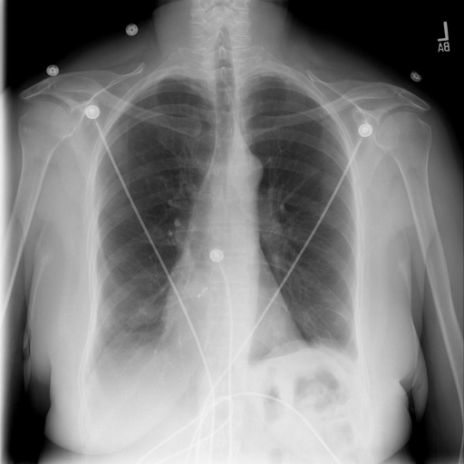

# chexbench_rad_restruct_0206
Ordinal 84; source Rad-Restruct; stopped-prefix record.

Are there any signs in the skeletal system?

## Complete options

- **A**: no
- **B**: yes

## Original images

Explicit answer: **A. no**; reference: **B**; correct: **False**.

Both medgemma and chest_xray_expert models found no evidence of fractures, dislocations, or bone lesions in the skeletal system.

[Prediction](../../evidence/chexbench/predictions/M43-IM-GT-S50-CXR6/chexbench_rad_restruct_0206.json) · [own post-prediction feedback](../../evidence/chexbench/feedback/chexbench_rad_restruct_0206.json) · [exact context and Skill version](../../evidence/chexbench/contexts/chexbench_rad_restruct_0206.json) · [all main requests/responses](../../evidence/chexbench/services/calls/R50-AGENT/chexbench_rad_restruct_0206)

## Tool requests and observations

- medgemma: status=completed; [selection](../../evidence/chexbench/services/tool_selections/R50-AGENT/chexbench_rad_restruct_0206/1.json), [full request/result/stdout/stderr artifacts](../../evidence/chexbench/services/tool_cache/fad06a76573c724a9b882f9964bf09a0df73bc37f6953684fb6f6b66422ec117).
- chest_xray_expert: status=completed; [selection](../../evidence/chexbench/services/tool_selections/R50-AGENT/chexbench_rad_restruct_0206/2.json), [full request/result/stdout/stderr artifacts](../../evidence/chexbench/services/tool_cache/22442862bd3c434e5df4ddb18d447ae68faf03eb6c714b5916707994dd8dba81).

## Skill and prior-image provenance

Selected IDs: []; prior same-image IDs: [].

This is dataset-label scoring and model/tool narrative, not clinical adjudication or Skill causal verification.
