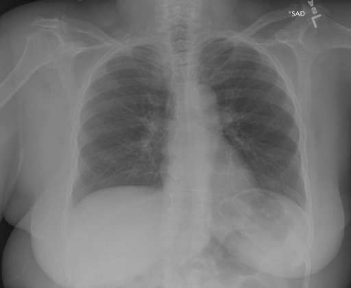

# chexbench_rad_restruct_0207
Ordinal 85; source Rad-Restruct; stopped-prefix record.

Are there any diseases in the skeletal system?

## Complete options

- **A**: no
- **B**: yes

## Original images

Explicit answer: **A. no**; reference: **B**; correct: **False**.

Expert models chest_xray_expert and llava_rad report no skeletal abnormalities, and visual inspection shows intact bones without fractures or deformity.

[Prediction](../../evidence/chexbench/predictions/M43-IM-GT-S50-CXR6/chexbench_rad_restruct_0207.json) · [own post-prediction feedback](../../evidence/chexbench/feedback/chexbench_rad_restruct_0207.json) · [exact context and Skill version](../../evidence/chexbench/contexts/chexbench_rad_restruct_0207.json) · [all main requests/responses](../../evidence/chexbench/services/calls/R50-AGENT/chexbench_rad_restruct_0207)

## Tool requests and observations

- medgemma: status=completed; [selection](../../evidence/chexbench/services/tool_selections/R50-AGENT/chexbench_rad_restruct_0207/1.json), [full request/result/stdout/stderr artifacts](../../evidence/chexbench/services/tool_cache/ec884ba5c15149ce82fb14b9a364ec9099ef45bee286b21fdba127263cd178e6).
- chest_xray_expert: status=completed; [selection](../../evidence/chexbench/services/tool_selections/R50-AGENT/chexbench_rad_restruct_0207/2.json), [full request/result/stdout/stderr artifacts](../../evidence/chexbench/services/tool_cache/9740b841b24374203aabfe88366eb8d66e033b5cf52bf86e88e7091222d5ddfe).
- llava_rad: status=completed; [selection](../../evidence/chexbench/services/tool_selections/R50-AGENT/chexbench_rad_restruct_0207/3.json), [full request/result/stdout/stderr artifacts](../../evidence/chexbench/services/tool_cache/289dccd6108879a562edd9ef75fddf84dbc61b0d27c280eee55259cac3c45405).

## Skill and prior-image provenance

Selected IDs: []; prior same-image IDs: [].

This is dataset-label scoring and model/tool narrative, not clinical adjudication or Skill causal verification.
