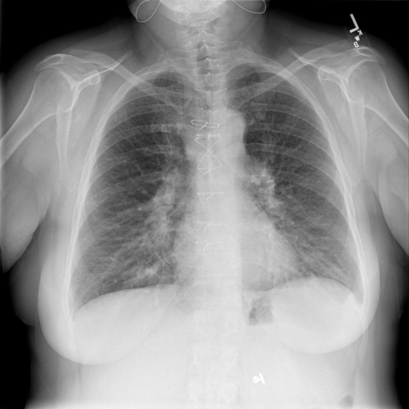

# chexbench_rad_restruct_0208
Ordinal 86; source Rad-Restruct; stopped-prefix record.

Are there any diseases in the lung?

## Complete options

- **A**: yes
- **B**: no

## Original images

Explicit answer: **B. no**; reference: **A**; correct: **False**.

Both MedGemma and CheXagent models found no evidence of consolidation, effusion, pneumothorax, or masses in the lung fields.

[Prediction](../../evidence/chexbench/predictions/M43-IM-GT-S50-CXR6/chexbench_rad_restruct_0208.json) · [own post-prediction feedback](../../evidence/chexbench/feedback/chexbench_rad_restruct_0208.json) · [exact context and Skill version](../../evidence/chexbench/contexts/chexbench_rad_restruct_0208.json) · [all main requests/responses](../../evidence/chexbench/services/calls/R50-AGENT/chexbench_rad_restruct_0208)

## Tool requests and observations

- medgemma: status=completed; [selection](../../evidence/chexbench/services/tool_selections/R50-AGENT/chexbench_rad_restruct_0208/1.json), [full request/result/stdout/stderr artifacts](../../evidence/chexbench/services/tool_cache/98cf690f2cd609e63f1c587576e04eb6281c72ce86df843d9f84683a8ca3c254).
- chest_xray_expert: status=completed; [selection](../../evidence/chexbench/services/tool_selections/R50-AGENT/chexbench_rad_restruct_0208/2.json), [full request/result/stdout/stderr artifacts](../../evidence/chexbench/services/tool_cache/560b3ef0e4b70fdf3a1072dcd65bbb5f739aea1f851b92496edecf54a2ea274d).

## Skill and prior-image provenance

Selected IDs: []; prior same-image IDs: [].

This is dataset-label scoring and model/tool narrative, not clinical adjudication or Skill causal verification.
