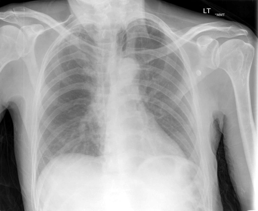

# chexbench_rad_restruct_0209
Ordinal 87; source Rad-Restruct; stopped-prefix record.

Is there anything abnormal in the lung?

## Complete options

- **A**: yes
- **B**: no

## Original images

Explicit answer: **B. no**; reference: **A**; correct: **False**.

Both medgemma and chest_xray_expert confirm the lung fields are clear with no evidence of consolidation, effusion, pneumothorax, or masses.

[Prediction](../../evidence/chexbench/predictions/M43-IM-GT-S50-CXR6/chexbench_rad_restruct_0209.json) · [own post-prediction feedback](../../evidence/chexbench/feedback/chexbench_rad_restruct_0209.json) · [exact context and Skill version](../../evidence/chexbench/contexts/chexbench_rad_restruct_0209.json) · [all main requests/responses](../../evidence/chexbench/services/calls/R50-AGENT/chexbench_rad_restruct_0209)

## Tool requests and observations

- medgemma: status=completed; [selection](../../evidence/chexbench/services/tool_selections/R50-AGENT/chexbench_rad_restruct_0209/1.json), [full request/result/stdout/stderr artifacts](../../evidence/chexbench/services/tool_cache/0b12b77ae17d4efede29855b18bf1d2795d11f40060faaf53e9be53202d1ec0f).
- chest_xray_expert: status=completed; [selection](../../evidence/chexbench/services/tool_selections/R50-AGENT/chexbench_rad_restruct_0209/2.json), [full request/result/stdout/stderr artifacts](../../evidence/chexbench/services/tool_cache/905101a82a5a199f8cb9f99ada3e0d0f2c71c2ffefc4157b8562aeafa469263f).

## Skill and prior-image provenance

Selected IDs: []; prior same-image IDs: [].

This is dataset-label scoring and model/tool narrative, not clinical adjudication or Skill causal verification.
