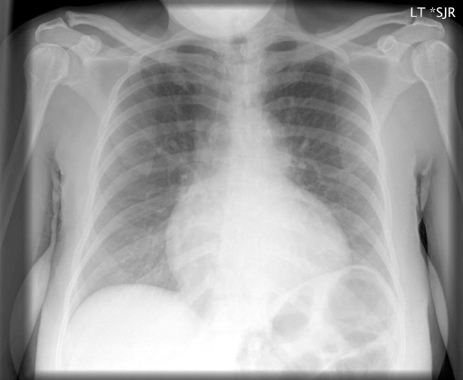

# chexbench_rad_restruct_0210
Ordinal 88; source Rad-Restruct; stopped-prefix record.

Are there any diseases in the lung?

## Complete options

- **A**: no
- **B**: yes

## Original images

Explicit answer: **A. no**; reference: **B**; correct: **False**.

All three models agree there are no signs of acute cardiopulmonary disease or lung pathology in the image.

[Prediction](../../evidence/chexbench/predictions/M43-IM-GT-S50-CXR6/chexbench_rad_restruct_0210.json) · [own post-prediction feedback](../../evidence/chexbench/feedback/chexbench_rad_restruct_0210.json) · [exact context and Skill version](../../evidence/chexbench/contexts/chexbench_rad_restruct_0210.json) · [all main requests/responses](../../evidence/chexbench/services/calls/R50-AGENT/chexbench_rad_restruct_0210)

## Tool requests and observations

- medgemma: status=completed; [selection](../../evidence/chexbench/services/tool_selections/R50-AGENT/chexbench_rad_restruct_0210/1.json), [full request/result/stdout/stderr artifacts](../../evidence/chexbench/services/tool_cache/cbe7739e850f6e23f1ade7fded38c59c0c869d71334f88aa6c6c558e7f49cdb5).
- llava_rad: status=completed; [selection](../../evidence/chexbench/services/tool_selections/R50-AGENT/chexbench_rad_restruct_0210/2.json), [full request/result/stdout/stderr artifacts](../../evidence/chexbench/services/tool_cache/a6148d14c536844f5efd6cc911abd4eb1f73d896dd8bad999944264f2f6fda37).
- chest_xray_expert: status=completed; [selection](../../evidence/chexbench/services/tool_selections/R50-AGENT/chexbench_rad_restruct_0210/3.json), [full request/result/stdout/stderr artifacts](../../evidence/chexbench/services/tool_cache/6e68d710ffe27c2a78338c9ca1757df9fa30f24f573d22e4de27c05e0c6ebe44).

## Skill and prior-image provenance

Selected IDs: []; prior same-image IDs: [].

This is dataset-label scoring and model/tool narrative, not clinical adjudication or Skill causal verification.
