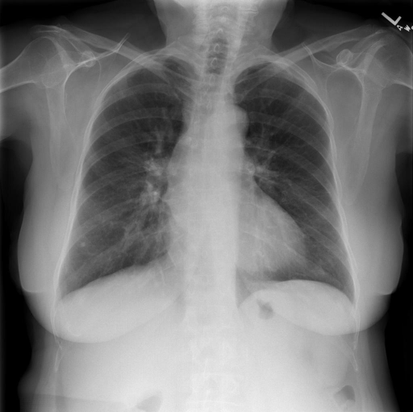
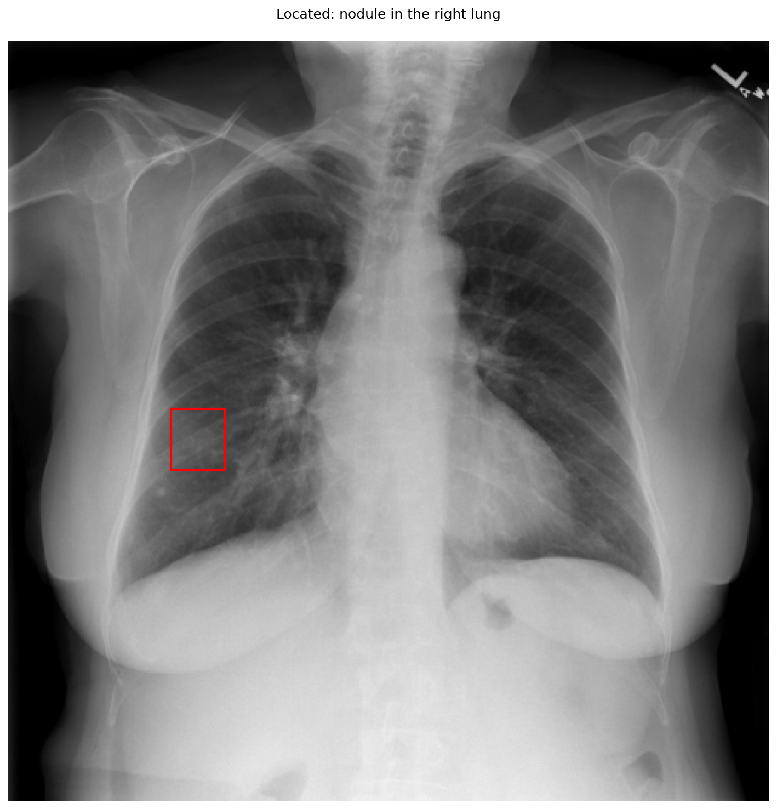

# chexbench_rad_restruct_0211
Ordinal 89; source Rad-Restruct; stopped-prefix record.

Are there any diseases in the lung?

## Complete options

- **A**: yes
- **B**: no

## Original images

Explicit answer: **A. yes**; reference: **A**; correct: **True**.

Grounding visualization confirms a nodule in the right lung, indicating disease presence despite conflicting model reports.

[Prediction](../../evidence/chexbench/predictions/M43-IM-GT-S50-CXR6/chexbench_rad_restruct_0211.json) · [own post-prediction feedback](../../evidence/chexbench/feedback/chexbench_rad_restruct_0211.json) · [exact context and Skill version](../../evidence/chexbench/contexts/chexbench_rad_restruct_0211.json) · [all main requests/responses](../../evidence/chexbench/services/calls/R50-AGENT/chexbench_rad_restruct_0211)

## Tool requests and observations

- medgemma: status=completed; [selection](../../evidence/chexbench/services/tool_selections/R50-AGENT/chexbench_rad_restruct_0211/1.json), [full request/result/stdout/stderr artifacts](../../evidence/chexbench/services/tool_cache/456e5c957da38c6429a643c0437a50ee1c0ac92be284b3d859adc2689e7ae2cf).
- llava_rad: status=completed; [selection](../../evidence/chexbench/services/tool_selections/R50-AGENT/chexbench_rad_restruct_0211/2.json), [full request/result/stdout/stderr artifacts](../../evidence/chexbench/services/tool_cache/6a776d0e8272a960d3d97d33ec02252550ec2706720157f79a8ff9fc46b26339).
- chest_xray_expert: status=completed; [selection](../../evidence/chexbench/services/tool_selections/R50-AGENT/chexbench_rad_restruct_0211/3.json), [full request/result/stdout/stderr artifacts](../../evidence/chexbench/services/tool_cache/67d3d84759499908f2a75413125644772301e51d94e2fa4e738328f43dee0a8a).
- xray_phrase_grounding: status=completed; [selection](../../evidence/chexbench/services/tool_selections/R50-AGENT/chexbench_rad_restruct_0211/4.json), [full request/result/stdout/stderr artifacts](../../evidence/chexbench/services/tool_cache/5622473a11f7c2a09b63e1dd50f3b2883d8ff3761740be26d701b147a88f9e33).

## Skill and prior-image provenance

Selected IDs: []; prior same-image IDs: [].

This is dataset-label scoring and model/tool narrative, not clinical adjudication or Skill causal verification.
