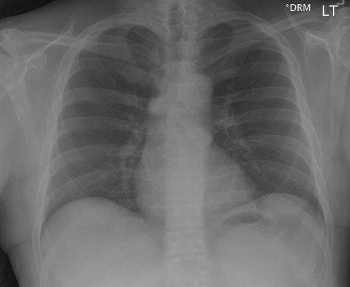

# chexbench_rad_restruct_0212
Ordinal 90; source Rad-Restruct; stopped-prefix record.

Are there any signs in the mediastinum?

## Complete options

- **A**: no
- **B**: yes

## Original images

Explicit answer: **A. no**; reference: **B**; correct: **False**.

Both medgemma and chest_xray_expert confirm the mediastinum appears normal without widening, mass, or abnormal contour.

[Prediction](../../evidence/chexbench/predictions/M43-IM-GT-S50-CXR6/chexbench_rad_restruct_0212.json) · [own post-prediction feedback](../../evidence/chexbench/feedback/chexbench_rad_restruct_0212.json) · [exact context and Skill version](../../evidence/chexbench/contexts/chexbench_rad_restruct_0212.json) · [all main requests/responses](../../evidence/chexbench/services/calls/R50-AGENT/chexbench_rad_restruct_0212)

## Tool requests and observations

- medgemma: status=completed; [selection](../../evidence/chexbench/services/tool_selections/R50-AGENT/chexbench_rad_restruct_0212/1.json), [full request/result/stdout/stderr artifacts](../../evidence/chexbench/services/tool_cache/718883802e774c3a583b448e2ad58411a90726544aba48b3e33319244bc49502).
- chest_xray_expert: status=completed; [selection](../../evidence/chexbench/services/tool_selections/R50-AGENT/chexbench_rad_restruct_0212/2.json), [full request/result/stdout/stderr artifacts](../../evidence/chexbench/services/tool_cache/2ba8cdff943214a040182e4c5faad8da2a1687a574c4fc1066b2482dc08a3f3a).

## Skill and prior-image provenance

Selected IDs: []; prior same-image IDs: [].

This is dataset-label scoring and model/tool narrative, not clinical adjudication or Skill causal verification.
