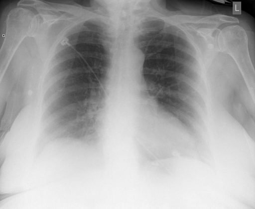

# chexbench_rad_restruct_0213
Ordinal 91; source Rad-Restruct; stopped-prefix record.

Is there anything abnormal in the skeletal system?

## Complete options

- **A**: no
- **B**: yes

## Original images

Explicit answer: **A. no**; reference: **B**; correct: **False**.

Both medgemma and chest_xray_expert confirm the skeletal structures appear intact with no obvious fractures or abnormalities.

[Prediction](../../evidence/chexbench/predictions/M43-IM-GT-S50-CXR6/chexbench_rad_restruct_0213.json) · [own post-prediction feedback](../../evidence/chexbench/feedback/chexbench_rad_restruct_0213.json) · [exact context and Skill version](../../evidence/chexbench/contexts/chexbench_rad_restruct_0213.json) · [all main requests/responses](../../evidence/chexbench/services/calls/R50-AGENT/chexbench_rad_restruct_0213)

## Tool requests and observations

- medgemma: status=completed; [selection](../../evidence/chexbench/services/tool_selections/R50-AGENT/chexbench_rad_restruct_0213/1.json), [full request/result/stdout/stderr artifacts](../../evidence/chexbench/services/tool_cache/04d6e318ee8cc73d5f976b1ea4e086d0986526bf0df962717385e18984a59673).
- chest_xray_expert: status=completed; [selection](../../evidence/chexbench/services/tool_selections/R50-AGENT/chexbench_rad_restruct_0213/2.json), [full request/result/stdout/stderr artifacts](../../evidence/chexbench/services/tool_cache/368ccfa8ea81b8400b8fb43f88542e51efb59019d9b6916cb87071efb38c609a).

## Skill and prior-image provenance

Selected IDs: []; prior same-image IDs: ['chexbench_rad_restruct_0145'].

This is dataset-label scoring and model/tool narrative, not clinical adjudication or Skill causal verification.
