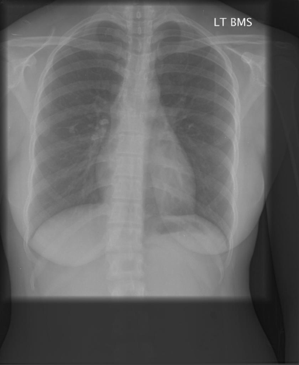

# chexbench_rad_restruct_0214
Ordinal 92; source Rad-Restruct; stopped-prefix record.

Are there any diseases in the lung?

## Complete options

- **A**: no
- **B**: yes

## Original images

Explicit answer: **A. no**; reference: **B**; correct: **False**.

Both MedGemma and CheXagent report no obvious signs of lung disease such as consolidation, effusion, pneumothorax, or masses on this chest X-ray.

[Prediction](../../evidence/chexbench/predictions/M43-IM-GT-S50-CXR6/chexbench_rad_restruct_0214.json) · [own post-prediction feedback](../../evidence/chexbench/feedback/chexbench_rad_restruct_0214.json) · [exact context and Skill version](../../evidence/chexbench/contexts/chexbench_rad_restruct_0214.json) · [all main requests/responses](../../evidence/chexbench/services/calls/R50-AGENT/chexbench_rad_restruct_0214)

## Tool requests and observations

- medgemma: status=completed; [selection](../../evidence/chexbench/services/tool_selections/R50-AGENT/chexbench_rad_restruct_0214/1.json), [full request/result/stdout/stderr artifacts](../../evidence/chexbench/services/tool_cache/46eadae1af28a3532405af5a30bc17ce5b8439ceed45fc76ef64e926b7c6aa61).
- chest_xray_expert: status=completed; [selection](../../evidence/chexbench/services/tool_selections/R50-AGENT/chexbench_rad_restruct_0214/2.json), [full request/result/stdout/stderr artifacts](../../evidence/chexbench/services/tool_cache/86c65c5fa50c085f7726c0157403dcd27f8b8f06b2e4e5295d8c0d85861d199e).

## Skill and prior-image provenance

Selected IDs: []; prior same-image IDs: [].

This is dataset-label scoring and model/tool narrative, not clinical adjudication or Skill causal verification.
