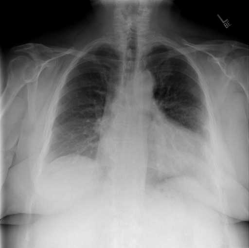

# chexbench_rad_restruct_0215
Ordinal 93; source Rad-Restruct; stopped-prefix record.

Are there any diseases in the cardiovascular system?

## Complete options

- **A**: no
- **B**: yes

## Original images

Explicit answer: **B. yes**; reference: **B**; correct: **True**.

Both medgemma and chest_xray_expert identified signs of cardiovascular disease, specifically cardiomegaly and vascular congestion.

[Prediction](../../evidence/chexbench/predictions/M43-IM-GT-S50-CXR6/chexbench_rad_restruct_0215.json) · [own post-prediction feedback](../../evidence/chexbench/feedback/chexbench_rad_restruct_0215.json) · [exact context and Skill version](../../evidence/chexbench/contexts/chexbench_rad_restruct_0215.json) · [all main requests/responses](../../evidence/chexbench/services/calls/R50-AGENT/chexbench_rad_restruct_0215)

## Tool requests and observations

- medgemma: status=completed; [selection](../../evidence/chexbench/services/tool_selections/R50-AGENT/chexbench_rad_restruct_0215/1.json), [full request/result/stdout/stderr artifacts](../../evidence/chexbench/services/tool_cache/dab2830a5b83ad1504ccf330a2a087e3521a41897fadfff7d2513707277dd6c4).
- chest_xray_expert: status=completed; [selection](../../evidence/chexbench/services/tool_selections/R50-AGENT/chexbench_rad_restruct_0215/2.json), [full request/result/stdout/stderr artifacts](../../evidence/chexbench/services/tool_cache/a1724a467c29f5d52b346cb2838f37764e299dd8a4c0370163a39229bdf86e3a).

## Skill and prior-image provenance

Selected IDs: []; prior same-image IDs: [].

This is dataset-label scoring and model/tool narrative, not clinical adjudication or Skill causal verification.
