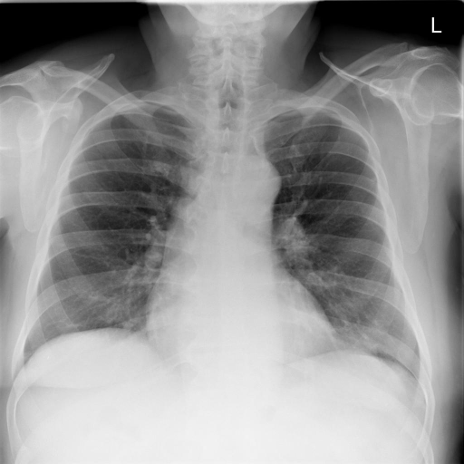

# chexbench_rad_restruct_0216
Ordinal 94; source Rad-Restruct; stopped-prefix record.

Is there anything abnormal in the skeletal system?

## Complete options

- **A**: no
- **B**: yes

## Original images

Explicit answer: **A. no**; reference: **B**; correct: **False**.

Both MedGemma and CheXagent confirm no visible skeletal abnormalities such as fractures or lytic lesions on the chest X-ray.

[Prediction](../../evidence/chexbench/predictions/M43-IM-GT-S50-CXR6/chexbench_rad_restruct_0216.json) · [own post-prediction feedback](../../evidence/chexbench/feedback/chexbench_rad_restruct_0216.json) · [exact context and Skill version](../../evidence/chexbench/contexts/chexbench_rad_restruct_0216.json) · [all main requests/responses](../../evidence/chexbench/services/calls/R50-AGENT/chexbench_rad_restruct_0216)

## Tool requests and observations

- medgemma: status=completed; [selection](../../evidence/chexbench/services/tool_selections/R50-AGENT/chexbench_rad_restruct_0216/1.json), [full request/result/stdout/stderr artifacts](../../evidence/chexbench/services/tool_cache/481dbe7b912de81ca259509afdd02b5436c33b7e53474cd58e1373f423cad646).
- chest_xray_expert: status=completed; [selection](../../evidence/chexbench/services/tool_selections/R50-AGENT/chexbench_rad_restruct_0216/2.json), [full request/result/stdout/stderr artifacts](../../evidence/chexbench/services/tool_cache/5f9e06d59c0358ec388d4e0281107ed87fd1b40dbd76e58ed77e28895e585465).

## Skill and prior-image provenance

Selected IDs: []; prior same-image IDs: [].

This is dataset-label scoring and model/tool narrative, not clinical adjudication or Skill causal verification.
