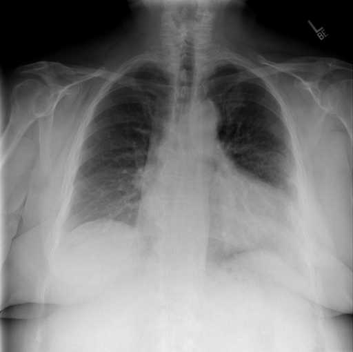

# chexbench_rad_restruct_0217
Ordinal 95; source Rad-Restruct; stopped-prefix record.

Are there any signs in the lung?

## Complete options

- **A**: yes
- **B**: no

## Original images

Explicit answer: **B. no**; reference: **A**; correct: **False**.

Multiple tools report clear lung fields without consolidation, effusion, or pneumothorax, and direct inspection shows no overt pulmonary abnormality.

[Prediction](../../evidence/chexbench/predictions/M43-IM-GT-S50-CXR6/chexbench_rad_restruct_0217.json) · [own post-prediction feedback](../../evidence/chexbench/feedback/chexbench_rad_restruct_0217.json) · [exact context and Skill version](../../evidence/chexbench/contexts/chexbench_rad_restruct_0217.json) · [all main requests/responses](../../evidence/chexbench/services/calls/R50-AGENT/chexbench_rad_restruct_0217)

## Tool requests and observations

- medgemma: status=completed; [selection](../../evidence/chexbench/services/tool_selections/R50-AGENT/chexbench_rad_restruct_0217/1.json), [full request/result/stdout/stderr artifacts](../../evidence/chexbench/services/tool_cache/ecad54dacecc7b437bb96125ff288c68c76e9ecb2670d4f42e5c30c8cab57528).
- chest_xray_expert: status=completed; [selection](../../evidence/chexbench/services/tool_selections/R50-AGENT/chexbench_rad_restruct_0217/2.json), [full request/result/stdout/stderr artifacts](../../evidence/chexbench/services/tool_cache/b8c76e56eeee273c7ec9c9a0e3fbc3cf93a92bdeae0a670da9e304a176381344).
- llava_rad: status=completed; [selection](../../evidence/chexbench/services/tool_selections/R50-AGENT/chexbench_rad_restruct_0217/3.json), [full request/result/stdout/stderr artifacts](../../evidence/chexbench/services/tool_cache/00accb04d06d8625a567bbd8969a5c97b9f16f9a9cdd7411c1e367fdc6b2914f).
- medvlm_r1: status=completed; [selection](../../evidence/chexbench/services/tool_selections/R50-AGENT/chexbench_rad_restruct_0217/4.json), [full request/result/stdout/stderr artifacts](../../evidence/chexbench/services/tool_cache/235684ff218771ca5b1da82287146f1be77b0f42a990b9f08f3f61362a3cec81).

## Skill and prior-image provenance

Selected IDs: []; prior same-image IDs: ['chexbench_rad_restruct_0215'].

This is dataset-label scoring and model/tool narrative, not clinical adjudication or Skill causal verification.
