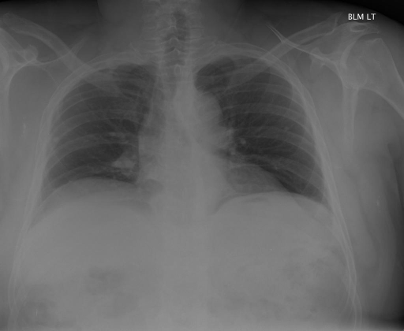
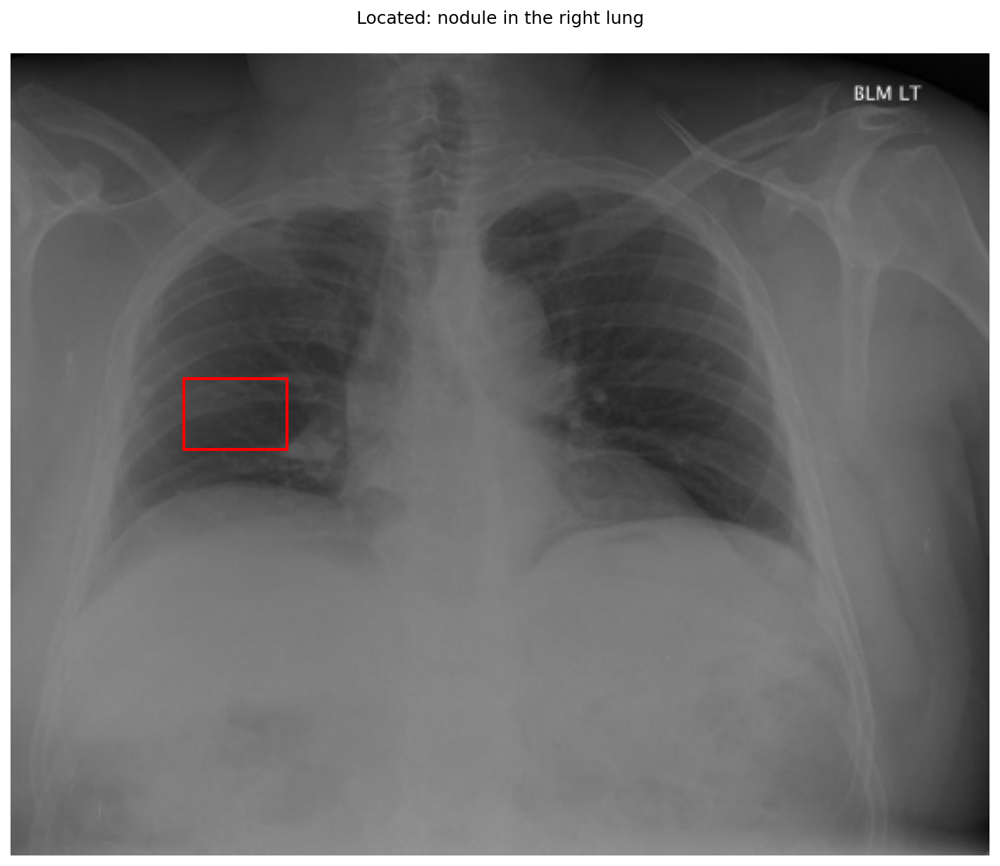

# chexbench_rad_restruct_0218
Ordinal 96; source Rad-Restruct; stopped-prefix record.

Is there anything abnormal in the lung?

## Complete options

- **A**: no
- **B**: yes

## Original images

Explicit answer: **B. yes**; reference: **B**; correct: **True**.

Phrase grounding and MedGemma identified a nodule in the right lung, confirming an abnormality.

[Prediction](../../evidence/chexbench/predictions/M43-IM-GT-S50-CXR6/chexbench_rad_restruct_0218.json) · [own post-prediction feedback](../../evidence/chexbench/feedback/chexbench_rad_restruct_0218.json) · [exact context and Skill version](../../evidence/chexbench/contexts/chexbench_rad_restruct_0218.json) · [all main requests/responses](../../evidence/chexbench/services/calls/R50-AGENT/chexbench_rad_restruct_0218)

## Tool requests and observations

- chest_xray_expert: status=completed; [selection](../../evidence/chexbench/services/tool_selections/R50-AGENT/chexbench_rad_restruct_0218/1.json), [full request/result/stdout/stderr artifacts](../../evidence/chexbench/services/tool_cache/ebdc9f436fe217582ccb3a9cdf522afadc463141ec9ce68216d1a17ed112ba72).
- medgemma: status=completed; [selection](../../evidence/chexbench/services/tool_selections/R50-AGENT/chexbench_rad_restruct_0218/2.json), [full request/result/stdout/stderr artifacts](../../evidence/chexbench/services/tool_cache/d20f600e94e1423d0ebf0a93cf08127b2ad348ba1a86b5630494d92a13832f5c).
- xray_phrase_grounding: status=completed; [selection](../../evidence/chexbench/services/tool_selections/R50-AGENT/chexbench_rad_restruct_0218/3.json), [full request/result/stdout/stderr artifacts](../../evidence/chexbench/services/tool_cache/52aee917e62f5285facfd7ca437d4662d4c03dca52fc497f587b3b3eb41505b7).

## Skill and prior-image provenance

Selected IDs: []; prior same-image IDs: ['chexbench_rad_restruct_0151', 'chexbench_rad_restruct_0161'].

This is dataset-label scoring and model/tool narrative, not clinical adjudication or Skill causal verification.
