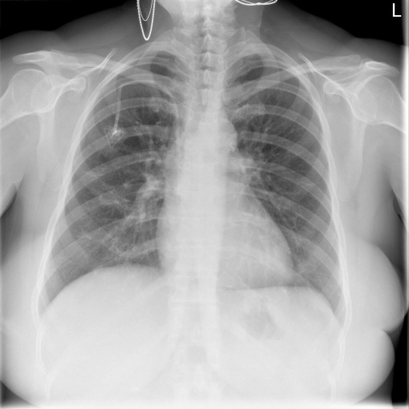

# chexbench_rad_restruct_0219
Ordinal 97; source Rad-Restruct; stopped-prefix record.

Are there any foreign objects?

## Complete options

- **A**: yes
- **B**: no

## Original images

Explicit answer: **A. yes**; reference: **A**; correct: **True**.

The chest X-ray shows a visible port-a-cath device in the right upper chest, confirming the presence of a foreign object.

[Prediction](../../evidence/chexbench/predictions/M43-IM-GT-S50-CXR6/chexbench_rad_restruct_0219.json) · [own post-prediction feedback](../../evidence/chexbench/feedback/chexbench_rad_restruct_0219.json) · [exact context and Skill version](../../evidence/chexbench/contexts/chexbench_rad_restruct_0219.json) · [all main requests/responses](../../evidence/chexbench/services/calls/R50-AGENT/chexbench_rad_restruct_0219)

## Tool requests and observations

- xray_phrase_grounding: status=completed; [selection](../../evidence/chexbench/services/tool_selections/R50-AGENT/chexbench_rad_restruct_0219/1.json), [full request/result/stdout/stderr artifacts](../../evidence/chexbench/services/tool_cache/9d6a997d9ef8f366e8a56d3f7f30d852a79acddc8703950683bd84c41a7690c5).
- chest_xray_expert: status=completed; [selection](../../evidence/chexbench/services/tool_selections/R50-AGENT/chexbench_rad_restruct_0219/2.json), [full request/result/stdout/stderr artifacts](../../evidence/chexbench/services/tool_cache/95b6ed4543d700ebd753b466041662ceac5fec10c8e6f46e639055312ef0e051).

## Skill and prior-image provenance

Selected IDs: []; prior same-image IDs: [].

This is dataset-label scoring and model/tool narrative, not clinical adjudication or Skill causal verification.
