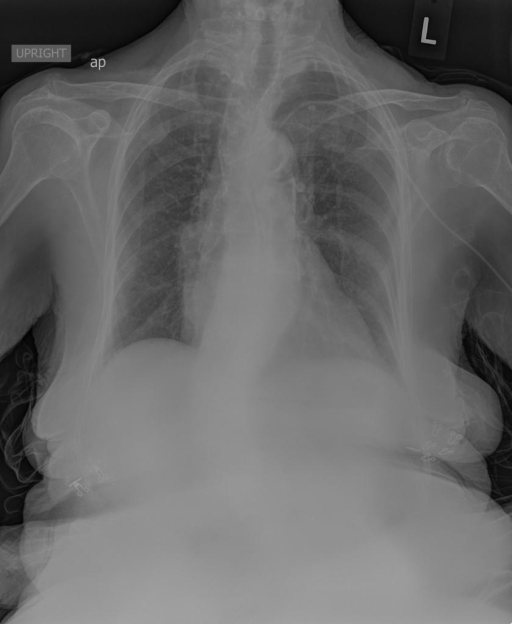

# chexbench_rad_restruct_0220
Ordinal 98; source Rad-Restruct; stopped-prefix record.

Are there any diseases in the cardiovascular system?

## Complete options

- **A**: yes
- **B**: no

## Original images

Explicit answer: **A. yes**; reference: **A**; correct: **True**.

Both models identified cardiovascular findings including mild cardiomegaly and aortic arch calcifications.

[Prediction](../../evidence/chexbench/predictions/M43-IM-GT-S50-CXR6/chexbench_rad_restruct_0220.json) · [own post-prediction feedback](../../evidence/chexbench/feedback/chexbench_rad_restruct_0220.json) · [exact context and Skill version](../../evidence/chexbench/contexts/chexbench_rad_restruct_0220.json) · [all main requests/responses](../../evidence/chexbench/services/calls/R50-AGENT/chexbench_rad_restruct_0220)

## Tool requests and observations

- medgemma: status=completed; [selection](../../evidence/chexbench/services/tool_selections/R50-AGENT/chexbench_rad_restruct_0220/1.json), [full request/result/stdout/stderr artifacts](../../evidence/chexbench/services/tool_cache/e2b3a4d7c8b1af9546ff0c30aa631e67351b40de702a55a59663040e8f4f7978).
- chest_xray_expert: status=completed; [selection](../../evidence/chexbench/services/tool_selections/R50-AGENT/chexbench_rad_restruct_0220/2.json), [full request/result/stdout/stderr artifacts](../../evidence/chexbench/services/tool_cache/b3d811f614fc5b5c8741ad6b64e8cb87c8ed641b8b5aa5f3433ca0ed59d6bca0).

## Skill and prior-image provenance

Selected IDs: []; prior same-image IDs: [].

This is dataset-label scoring and model/tool narrative, not clinical adjudication or Skill causal verification.
