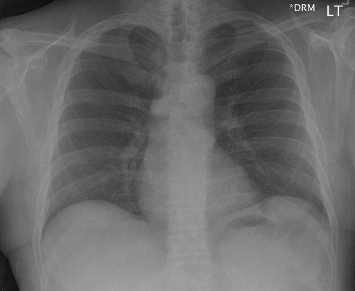

# chexbench_rad_restruct_0221
Ordinal 99; source Rad-Restruct; stopped-prefix record.

Are there any signs in the trachea?

## Complete options

- **A**: no
- **B**: yes

## Original images

Explicit answer: **A. no**; reference: **B**; correct: **False**.

Both medgemma and chest_xray_expert confirm the trachea is midline and normal without deviation, narrowing, or mass effect.

[Prediction](../../evidence/chexbench/predictions/M43-IM-GT-S50-CXR6/chexbench_rad_restruct_0221.json) · [own post-prediction feedback](../../evidence/chexbench/feedback/chexbench_rad_restruct_0221.json) · [exact context and Skill version](../../evidence/chexbench/contexts/chexbench_rad_restruct_0221.json) · [all main requests/responses](../../evidence/chexbench/services/calls/R50-AGENT/chexbench_rad_restruct_0221)

## Tool requests and observations

- medgemma: status=completed; [selection](../../evidence/chexbench/services/tool_selections/R50-AGENT/chexbench_rad_restruct_0221/1.json), [full request/result/stdout/stderr artifacts](../../evidence/chexbench/services/tool_cache/c7281453bb0625e2505beb58c873688a380b9fb803697c9f900993fe8e1081ad).
- chest_xray_expert: status=completed; [selection](../../evidence/chexbench/services/tool_selections/R50-AGENT/chexbench_rad_restruct_0221/2.json), [full request/result/stdout/stderr artifacts](../../evidence/chexbench/services/tool_cache/8444438e03cc5f31ce04e4848cdeab7c8c0c7d478e89a9bf40d943627a2a24d0).

## Skill and prior-image provenance

Selected IDs: []; prior same-image IDs: ['chexbench_rad_restruct_0212'].

This is dataset-label scoring and model/tool narrative, not clinical adjudication or Skill causal verification.
