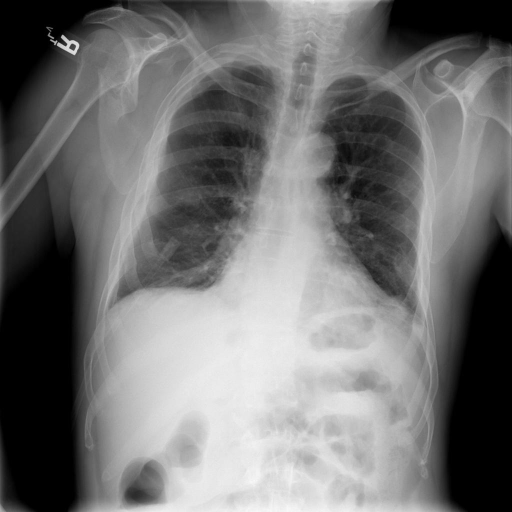

# chexbench_rad_restruct_0222
Ordinal 100; source Rad-Restruct; stopped-prefix record.

Are there any signs in the lung?

## Complete options

- **A**: no
- **B**: yes

## Original images

Explicit answer: **A. no**; reference: **B**; correct: **False**.

Both MedGemma and CheXagent models report no visible signs of lung pathology such as consolidation, effusion, or pneumothorax in the provided chest X-ray.

[Prediction](../../evidence/chexbench/predictions/M43-IM-GT-S50-CXR6/chexbench_rad_restruct_0222.json) · [own post-prediction feedback](../../evidence/chexbench/feedback/chexbench_rad_restruct_0222.json) · [exact context and Skill version](../../evidence/chexbench/contexts/chexbench_rad_restruct_0222.json) · [all main requests/responses](../../evidence/chexbench/services/calls/R50-AGENT/chexbench_rad_restruct_0222)

## Tool requests and observations

- medgemma: status=completed; [selection](../../evidence/chexbench/services/tool_selections/R50-AGENT/chexbench_rad_restruct_0222/1.json), [full request/result/stdout/stderr artifacts](../../evidence/chexbench/services/tool_cache/920b5baf485780fd21a72836ea9ebe280e58b68ab2b1c15103bc1f7224284e3b).
- chest_xray_expert: status=completed; [selection](../../evidence/chexbench/services/tool_selections/R50-AGENT/chexbench_rad_restruct_0222/2.json), [full request/result/stdout/stderr artifacts](../../evidence/chexbench/services/tool_cache/8a39c31bc6c3f706a90af1303725842c6a8e3758996d0a2539ee3bd98822640b).

## Skill and prior-image provenance

Selected IDs: []; prior same-image IDs: [].

This is dataset-label scoring and model/tool narrative, not clinical adjudication or Skill causal verification.
