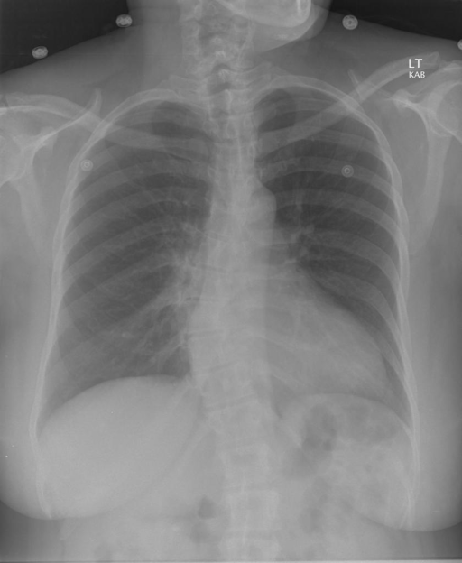

# chexbench_rad_restruct_0223
Ordinal 101; source Rad-Restruct; stopped-prefix record.

Are there any diseases in the skeletal system?

## Complete options

- **A**: no
- **B**: yes

## Original images

Explicit answer: **B. yes**; reference: **B**; correct: **True**.

Both medgemma and chest_xray_expert identify scoliosis, a skeletal system disease, visible in the spine on this chest X-ray.

[Prediction](../../evidence/chexbench/predictions/M43-IM-GT-S50-CXR6/chexbench_rad_restruct_0223.json) · [own post-prediction feedback](../../evidence/chexbench/feedback/chexbench_rad_restruct_0223.json) · [exact context and Skill version](../../evidence/chexbench/contexts/chexbench_rad_restruct_0223.json) · [all main requests/responses](../../evidence/chexbench/services/calls/R50-AGENT/chexbench_rad_restruct_0223)

## Tool requests and observations

- medgemma: status=completed; [selection](../../evidence/chexbench/services/tool_selections/R50-AGENT/chexbench_rad_restruct_0223/1.json), [full request/result/stdout/stderr artifacts](../../evidence/chexbench/services/tool_cache/f11d0f457e54406c5cea355d0321c78baa4fc1d59118dadfa759819af7a6b288).
- chest_xray_expert: status=completed; [selection](../../evidence/chexbench/services/tool_selections/R50-AGENT/chexbench_rad_restruct_0223/2.json), [full request/result/stdout/stderr artifacts](../../evidence/chexbench/services/tool_cache/8cb291f862df913c3db986e5262adc74546d0e9abc11150a4f51651e86cf99b1).

## Skill and prior-image provenance

Selected IDs: []; prior same-image IDs: ['chexbench_rad_restruct_0162'].

This is dataset-label scoring and model/tool narrative, not clinical adjudication or Skill causal verification.
