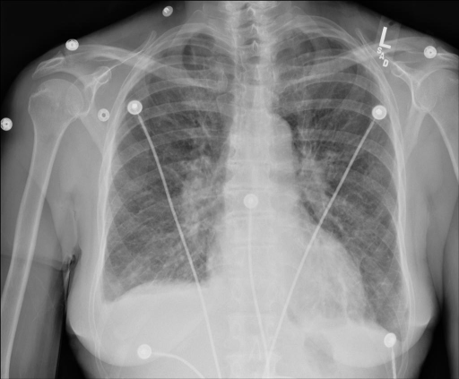

# chexbench_rad_restruct_0224
Ordinal 102; source Rad-Restruct; stopped-prefix record.

Are there any diseases in the lung?

## Complete options

- **A**: yes
- **B**: no

## Original images

Explicit answer: **A. yes**; reference: **A**; correct: **True**.

Both medgemma and chest_xray_expert identify signs of lung disease, including increased interstitial markings and possible pleural effusion.

[Prediction](../../evidence/chexbench/predictions/M43-IM-GT-S50-CXR6/chexbench_rad_restruct_0224.json) · [own post-prediction feedback](../../evidence/chexbench/feedback/chexbench_rad_restruct_0224.json) · [exact context and Skill version](../../evidence/chexbench/contexts/chexbench_rad_restruct_0224.json) · [all main requests/responses](../../evidence/chexbench/services/calls/R50-AGENT/chexbench_rad_restruct_0224)

## Tool requests and observations

- medgemma: status=completed; [selection](../../evidence/chexbench/services/tool_selections/R50-AGENT/chexbench_rad_restruct_0224/1.json), [full request/result/stdout/stderr artifacts](../../evidence/chexbench/services/tool_cache/441ce7f1a55451fd816a320c977ff175b57791d228eca9f20e3a41e2d7b3f813).
- chest_xray_expert: status=completed; [selection](../../evidence/chexbench/services/tool_selections/R50-AGENT/chexbench_rad_restruct_0224/2.json), [full request/result/stdout/stderr artifacts](../../evidence/chexbench/services/tool_cache/aa73da642020b99fd68835261fafce042b448b34ae49b862e4d5958df2924d5a).

## Skill and prior-image provenance

Selected IDs: []; prior same-image IDs: [].

This is dataset-label scoring and model/tool narrative, not clinical adjudication or Skill causal verification.
