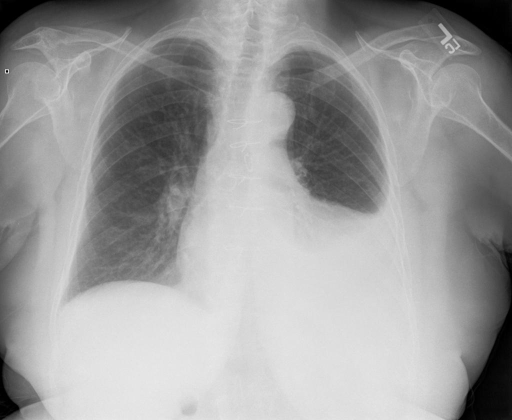

# chexbench_rad_restruct_0225
Ordinal 103; source Rad-Restruct; stopped-prefix record.

Are there any foreign objects?

## Complete options

- **A**: no
- **B**: yes

## Original images

Explicit answer: **A. no**; reference: **B**; correct: **False**.

Both phrase grounding and expert VQA confirm no foreign objects are visible in the chest X-ray.

[Prediction](../../evidence/chexbench/predictions/M43-IM-GT-S50-CXR6/chexbench_rad_restruct_0225.json) · [own post-prediction feedback](../../evidence/chexbench/feedback/chexbench_rad_restruct_0225.json) · [exact context and Skill version](../../evidence/chexbench/contexts/chexbench_rad_restruct_0225.json) · [all main requests/responses](../../evidence/chexbench/services/calls/R50-AGENT/chexbench_rad_restruct_0225)

## Tool requests and observations

- xray_phrase_grounding: status=completed; [selection](../../evidence/chexbench/services/tool_selections/R50-AGENT/chexbench_rad_restruct_0225/1.json), [full request/result/stdout/stderr artifacts](../../evidence/chexbench/services/tool_cache/bb7f90b78807b7cb5bd4cc063c3a463988ba0f3511e1eeec95cccb66c933d4d9).
- chest_xray_expert: status=completed; [selection](../../evidence/chexbench/services/tool_selections/R50-AGENT/chexbench_rad_restruct_0225/2.json), [full request/result/stdout/stderr artifacts](../../evidence/chexbench/services/tool_cache/56228ee55cbbd1f526576ef7e6898b8bb685dcbfdaffff210a41d41393dbe270).

## Skill and prior-image provenance

Selected IDs: []; prior same-image IDs: [].

This is dataset-label scoring and model/tool narrative, not clinical adjudication or Skill causal verification.
