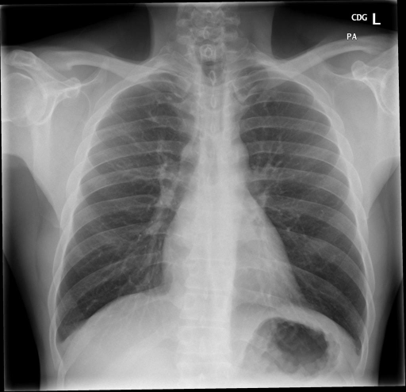

# chexbench_rad_restruct_0226
Ordinal 104; source Rad-Restruct; stopped-prefix record.

Are there any diseases in the lung?

## Complete options

- **A**: yes
- **B**: no

## Original images

Explicit answer: **B. no**; reference: **A**; correct: **False**.

All three models consistently report clear lungs with no evidence of disease, consolidation, effusion, or masses.

[Prediction](../../evidence/chexbench/predictions/M43-IM-GT-S50-CXR6/chexbench_rad_restruct_0226.json) · [own post-prediction feedback](../../evidence/chexbench/feedback/chexbench_rad_restruct_0226.json) · [exact context and Skill version](../../evidence/chexbench/contexts/chexbench_rad_restruct_0226.json) · [all main requests/responses](../../evidence/chexbench/services/calls/R50-AGENT/chexbench_rad_restruct_0226)

## Tool requests and observations

- medgemma: status=completed; [selection](../../evidence/chexbench/services/tool_selections/R50-AGENT/chexbench_rad_restruct_0226/1.json), [full request/result/stdout/stderr artifacts](../../evidence/chexbench/services/tool_cache/db4096960d41ef39c5e7084acc4882ba3a23c7245896c7b8bc574d9bd8c54ec4).
- llava_rad: status=completed; [selection](../../evidence/chexbench/services/tool_selections/R50-AGENT/chexbench_rad_restruct_0226/2.json), [full request/result/stdout/stderr artifacts](../../evidence/chexbench/services/tool_cache/367dff1efd55913aa963371a0ccc5ee14e5ddff77231ac4545830c016b2a065e).
- chest_xray_expert: status=completed; [selection](../../evidence/chexbench/services/tool_selections/R50-AGENT/chexbench_rad_restruct_0226/3.json), [full request/result/stdout/stderr artifacts](../../evidence/chexbench/services/tool_cache/bc139ce5f0b30c30b406caee191c15e67992518744774e71a96783f25061fb36).

## Skill and prior-image provenance

Selected IDs: []; prior same-image IDs: [].

This is dataset-label scoring and model/tool narrative, not clinical adjudication or Skill causal verification.
