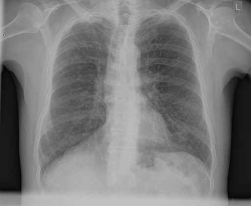
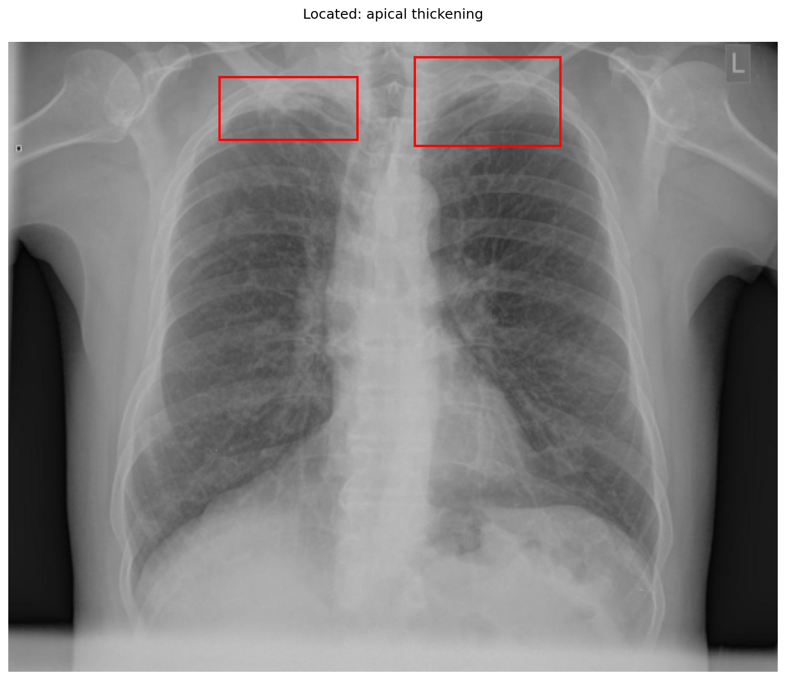

# chexbench_rad_restruct_0227
Ordinal 105; source Rad-Restruct; stopped-prefix record.

Are there any signs in the lung?

## Complete options

- **A**: yes
- **B**: no

## Original images

Explicit answer: **A**; reference: **A**; correct: **True**.

Grounding confirms bilateral apical thickening, indicating signs in the lung.

[Prediction](../../evidence/chexbench/predictions/M43-IM-GT-S50-CXR6/chexbench_rad_restruct_0227.json) · [own post-prediction feedback](../../evidence/chexbench/feedback/chexbench_rad_restruct_0227.json) · [exact context and Skill version](../../evidence/chexbench/contexts/chexbench_rad_restruct_0227.json) · [all main requests/responses](../../evidence/chexbench/services/calls/R50-AGENT/chexbench_rad_restruct_0227)

## Tool requests and observations

- medgemma: status=completed; [selection](../../evidence/chexbench/services/tool_selections/R50-AGENT/chexbench_rad_restruct_0227/1.json), [full request/result/stdout/stderr artifacts](../../evidence/chexbench/services/tool_cache/8f12bd282bc9d19c6bd940c466ec0d825be4ee7f82727a966ebb6b3fa727a237).
- llava_rad: status=completed; [selection](../../evidence/chexbench/services/tool_selections/R50-AGENT/chexbench_rad_restruct_0227/2.json), [full request/result/stdout/stderr artifacts](../../evidence/chexbench/services/tool_cache/d07428fc2e8d001bf0433fab98e6ff25fe5c336816a0a3ea64af49369baa1280).
- chest_xray_expert: status=completed; [selection](../../evidence/chexbench/services/tool_selections/R50-AGENT/chexbench_rad_restruct_0227/3.json), [full request/result/stdout/stderr artifacts](../../evidence/chexbench/services/tool_cache/c7c1f05e178e8f83b24a799639c167d764c7d464593ae4e13091fe434a8b3675).
- xray_phrase_grounding: status=completed; [selection](../../evidence/chexbench/services/tool_selections/R50-AGENT/chexbench_rad_restruct_0227/4.json), [full request/result/stdout/stderr artifacts](../../evidence/chexbench/services/tool_cache/e6cf3cb57b45cfb2325cdfda3900515c7ba5017b01fe1915c8dacbe05ea83341).

- medvlm_r1: status=completed; [selection](../../evidence/chexbench/services/tool_selections/R50-AGENT/chexbench_rad_restruct_0227/5.json), [full request/result/stdout/stderr artifacts](../../evidence/chexbench/services/tool_cache/42a5ac09c93a6ac19d79b02eda81d4d4c33048eb56c955ed457f0ce5d6d8c09e).

## Skill and prior-image provenance

Selected IDs: []; prior same-image IDs: [].

This is dataset-label scoring and model/tool narrative, not clinical adjudication or Skill causal verification.
