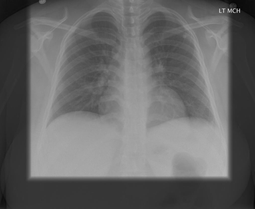

# chexbench_rad_restruct_0228
Ordinal 106; source Rad-Restruct; stopped-prefix record.

Are there any signs in the lung?

## Complete options

- **A**: yes
- **B**: no

## Original images

Explicit answer: **B. no**; reference: **A**; correct: **False**.

Both MedGemma and CheXagent confirm no visible signs of lung pathology such as consolidation, effusion, pneumothorax, or masses in the chest X-ray.

[Prediction](../../evidence/chexbench/predictions/M43-IM-GT-S50-CXR6/chexbench_rad_restruct_0228.json) · [own post-prediction feedback](../../evidence/chexbench/feedback/chexbench_rad_restruct_0228.json) · [exact context and Skill version](../../evidence/chexbench/contexts/chexbench_rad_restruct_0228.json) · [all main requests/responses](../../evidence/chexbench/services/calls/R50-AGENT/chexbench_rad_restruct_0228)

## Tool requests and observations

- medgemma: status=completed; [selection](../../evidence/chexbench/services/tool_selections/R50-AGENT/chexbench_rad_restruct_0228/1.json), [full request/result/stdout/stderr artifacts](../../evidence/chexbench/services/tool_cache/da9363a485d403df8be3c72cddeb0b1a5af54f0f8b4a0e9dd8aa34136d0c1964).
- chest_xray_expert: status=completed; [selection](../../evidence/chexbench/services/tool_selections/R50-AGENT/chexbench_rad_restruct_0228/2.json), [full request/result/stdout/stderr artifacts](../../evidence/chexbench/services/tool_cache/686efc40d769039268228c4f92525d43277011797b6c9c5eea22bf468106ce24).

## Skill and prior-image provenance

Selected IDs: []; prior same-image IDs: [].

This is dataset-label scoring and model/tool narrative, not clinical adjudication or Skill causal verification.
