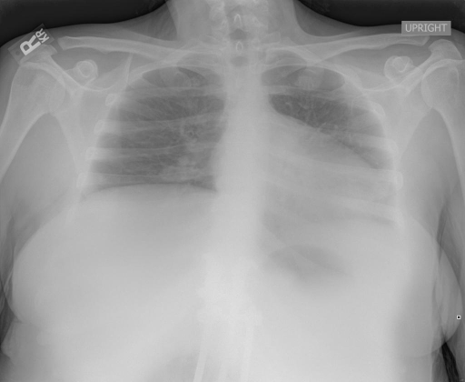

# chexbench_rad_restruct_0229
Ordinal 107; source Rad-Restruct; stopped-prefix record.

Are there any diseases in the lung?

## Complete options

- **A**: no
- **B**: yes

## Original images

Explicit answer: **A. no**; reference: **B**; correct: **False**.

All three models agree there are no obvious signs of lung disease, with llava_rad noting only low lung volumes and chest_xray_expert explicitly answering 'No'.

[Prediction](../../evidence/chexbench/predictions/M43-IM-GT-S50-CXR6/chexbench_rad_restruct_0229.json) · [own post-prediction feedback](../../evidence/chexbench/feedback/chexbench_rad_restruct_0229.json) · [exact context and Skill version](../../evidence/chexbench/contexts/chexbench_rad_restruct_0229.json) · [all main requests/responses](../../evidence/chexbench/services/calls/R50-AGENT/chexbench_rad_restruct_0229)

## Tool requests and observations

- medgemma: status=completed; [selection](../../evidence/chexbench/services/tool_selections/R50-AGENT/chexbench_rad_restruct_0229/1.json), [full request/result/stdout/stderr artifacts](../../evidence/chexbench/services/tool_cache/1522caf393199be658794f3a8edb0a5614794b0d42b5d5053dbcd92a475ad20a).
- llava_rad: status=completed; [selection](../../evidence/chexbench/services/tool_selections/R50-AGENT/chexbench_rad_restruct_0229/2.json), [full request/result/stdout/stderr artifacts](../../evidence/chexbench/services/tool_cache/aaedcdb6b0e92b91154f74695a299b5d2b00fa30ba426dce510d796030e47344).
- chest_xray_expert: status=completed; [selection](../../evidence/chexbench/services/tool_selections/R50-AGENT/chexbench_rad_restruct_0229/3.json), [full request/result/stdout/stderr artifacts](../../evidence/chexbench/services/tool_cache/ffbcfa78e29b2953e530782380add2fd0d98b9d766d10dbd52a62d61ab6ce4e7).

## Skill and prior-image provenance

Selected IDs: []; prior same-image IDs: [].

This is dataset-label scoring and model/tool narrative, not clinical adjudication or Skill causal verification.
