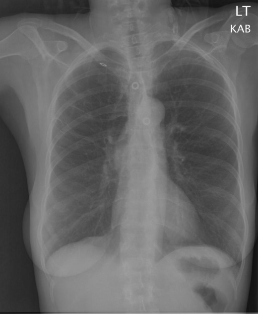

# chexbench_rad_restruct_0230
Ordinal 108; source Rad-Restruct; stopped-prefix record.

Is there anything abnormal in the lung?

## Complete options

- **A**: yes
- **B**: no

## Original images

Explicit answer: **B. no**; reference: **A**; correct: **False**.

Both expert models and visual inspection confirm clear lung fields without consolidation, mass, effusion, or pneumothorax.

[Prediction](../../evidence/chexbench/predictions/M43-IM-GT-S50-CXR6/chexbench_rad_restruct_0230.json) · [own post-prediction feedback](../../evidence/chexbench/feedback/chexbench_rad_restruct_0230.json) · [exact context and Skill version](../../evidence/chexbench/contexts/chexbench_rad_restruct_0230.json) · [all main requests/responses](../../evidence/chexbench/services/calls/R50-AGENT/chexbench_rad_restruct_0230)

## Tool requests and observations

- medgemma: status=completed; [selection](../../evidence/chexbench/services/tool_selections/R50-AGENT/chexbench_rad_restruct_0230/1.json), [full request/result/stdout/stderr artifacts](../../evidence/chexbench/services/tool_cache/307807a10324b4d66fb9b91c12b907485f536002cca3a51c38b0112a88f2f0c7).
- chest_xray_expert: status=completed; [selection](../../evidence/chexbench/services/tool_selections/R50-AGENT/chexbench_rad_restruct_0230/2.json), [full request/result/stdout/stderr artifacts](../../evidence/chexbench/services/tool_cache/286177c04608ae4bc665eaf6a267da7ca2f3211727c0e8fcb714df97d29c8b31).

## Skill and prior-image provenance

Selected IDs: []; prior same-image IDs: ['chexbench_rad_restruct_0125'].

This is dataset-label scoring and model/tool narrative, not clinical adjudication or Skill causal verification.
