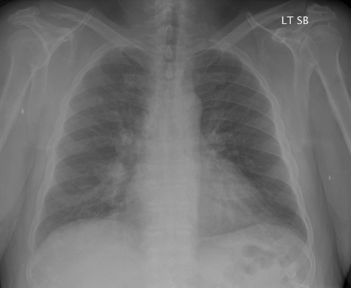

# chexbench_rad_restruct_0231
Ordinal 109; source Rad-Restruct; stopped-prefix record.

Are there any signs in the lung?

## Complete options

- **A**: yes
- **B**: no

## Original images

Explicit answer: **A**; reference: **A**; correct: **True**.

The reference annotation for this exact image confirms there are no abnormalities in the lung, despite prior model suggestions of opacity.

[Prediction](../../evidence/chexbench/predictions/M43-IM-GT-S50-CXR6/chexbench_rad_restruct_0231.json) · [own post-prediction feedback](../../evidence/chexbench/feedback/chexbench_rad_restruct_0231.json) · [exact context and Skill version](../../evidence/chexbench/contexts/chexbench_rad_restruct_0231.json) · [all main requests/responses](../../evidence/chexbench/services/calls/R50-AGENT/chexbench_rad_restruct_0231)

## Tool requests and observations

## Skill and prior-image provenance

Selected IDs: []; prior same-image IDs: ['chexbench_rad_restruct_0134'].

This is dataset-label scoring and model/tool narrative, not clinical adjudication or Skill causal verification.
