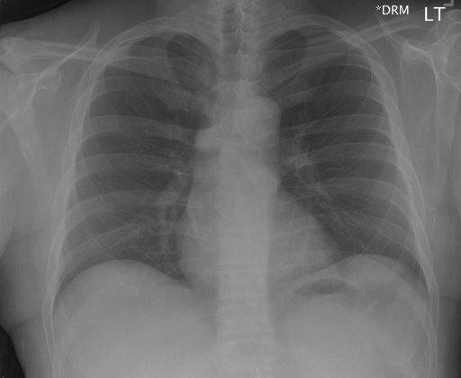

# chexbench_rad_restruct_0232
Ordinal 110; source Rad-Restruct; stopped-prefix record.

Are there any diseases in the trachea?

## Complete options

- **A**: yes
- **B**: no

## Original images

Explicit answer: **B. no**; reference: **A**; correct: **False**.

Both chest_xray_expert and medgemma confirm the trachea is midline with normal caliber and no visible disease, consistent with direct pixel inspection showing a clear air column.

[Prediction](../../evidence/chexbench/predictions/M43-IM-GT-S50-CXR6/chexbench_rad_restruct_0232.json) · [own post-prediction feedback](../../evidence/chexbench/feedback/chexbench_rad_restruct_0232.json) · [exact context and Skill version](../../evidence/chexbench/contexts/chexbench_rad_restruct_0232.json) · [all main requests/responses](../../evidence/chexbench/services/calls/R50-AGENT/chexbench_rad_restruct_0232)

## Tool requests and observations

- chest_xray_expert: status=completed; [selection](../../evidence/chexbench/services/tool_selections/R50-AGENT/chexbench_rad_restruct_0232/1.json), [full request/result/stdout/stderr artifacts](../../evidence/chexbench/services/tool_cache/ffe14a14a217585c31f19864b8c7462c0062534c08c63ba10a5e0813632cc62b).
- medgemma: status=completed; [selection](../../evidence/chexbench/services/tool_selections/R50-AGENT/chexbench_rad_restruct_0232/2.json), [full request/result/stdout/stderr artifacts](../../evidence/chexbench/services/tool_cache/d020ed3dbd0946b282bfae0bd43f8c8ff32a30780c21b8ac2e302aaaeea41dd4).

## Skill and prior-image provenance

Selected IDs: []; prior same-image IDs: ['chexbench_rad_restruct_0212', 'chexbench_rad_restruct_0221'].

This is dataset-label scoring and model/tool narrative, not clinical adjudication or Skill causal verification.
