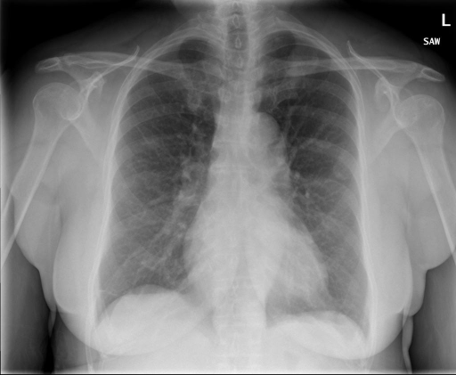

# chexbench_rad_restruct_0233
Ordinal 111; source Rad-Restruct; stopped-prefix record.

Is there anything abnormal in the cardiovascular system?

## Complete options

- **A**: no
- **B**: yes

## Original images

Explicit answer: **A. no**; reference: **B**; correct: **False**.

Both expert models agree the cardiac silhouette is normal and there are no cardiovascular abnormalities.

[Prediction](../../evidence/chexbench/predictions/M43-IM-GT-S50-CXR6/chexbench_rad_restruct_0233.json) · [own post-prediction feedback](../../evidence/chexbench/feedback/chexbench_rad_restruct_0233.json) · [exact context and Skill version](../../evidence/chexbench/contexts/chexbench_rad_restruct_0233.json) · [all main requests/responses](../../evidence/chexbench/services/calls/R50-AGENT/chexbench_rad_restruct_0233)

## Tool requests and observations

- medgemma: status=completed; [selection](../../evidence/chexbench/services/tool_selections/R50-AGENT/chexbench_rad_restruct_0233/1.json), [full request/result/stdout/stderr artifacts](../../evidence/chexbench/services/tool_cache/6645a298a52219daf4a8d9435cf4f72a5691a253f554deaab2d30f311f02bd12).
- chest_xray_expert: status=completed; [selection](../../evidence/chexbench/services/tool_selections/R50-AGENT/chexbench_rad_restruct_0233/2.json), [full request/result/stdout/stderr artifacts](../../evidence/chexbench/services/tool_cache/e54e148148cac903ad768e3cccbe3d547c4d5b6ca597de2aaee742cd8f572c22).

## Skill and prior-image provenance

Selected IDs: []; prior same-image IDs: [].

This is dataset-label scoring and model/tool narrative, not clinical adjudication or Skill causal verification.
